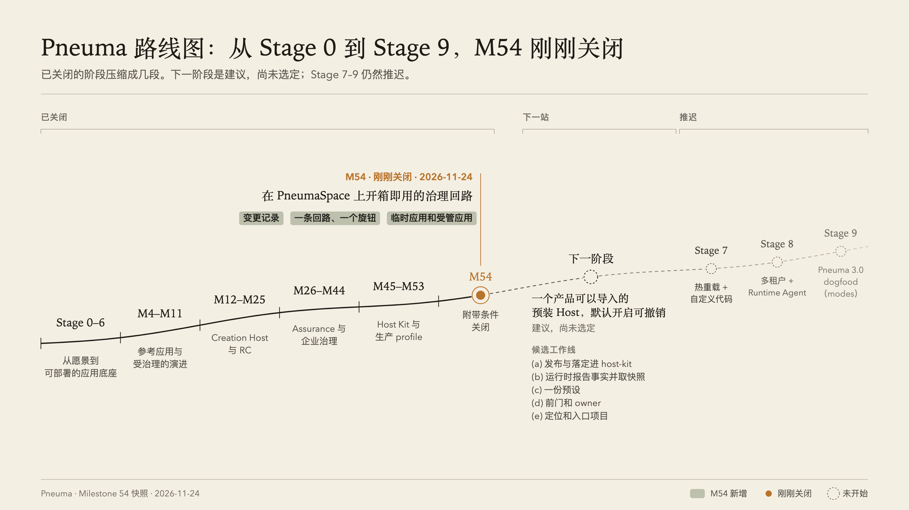

# Roadmap

**Last updated:** 2026-11-24
**Status:** 项目当前唯一 roadmap，单一 source of truth
**Supersedes:** v0 design spec 的 M0–M6（见 [ADR-0029](./adr/0029-supersede-v0-design-spec.md)）

> 本文档**不**累积历史进度报告。已完成阶段只留一句话总结 + 关键 ADR 链接。
> 已闭合阶段的细节进 milestone snapshot；未闭合阶段的开放问题进 OPEN-QUESTIONS。

---

## 阶段总览



```text
Stage 0   Vision + Architecture           ✅  CLOSED
Stage 1   Core-domain primitives          ✅  CLOSED
Stage 2   Runtime + lifecycle infra       ✅  CLOSED
Stage 3   Agent-in-loop wire              ✅  CLOSED
Stage 4   App-definition primitive        ✅  M1 closed
Stage 5   Enterprise governance hardening ✅  M2 closed
Stage 6   Deployable app substrate         ✅  M3 closed
M4        Reference app prototype          ✅  Knowledge Inbox closed
M5        Builder evolves reference app    ✅  Closed
M6        Real backend-agent evolution     ✅  Closed
M7        Capability change-set approval   ✅  Closed
M8        Release packaging hardening      ✅  Closed
M9        Creation-to-release integrity    ✅  Closed
M10       Derived semantic index           ✅  Closed
M11       Rollout adapter v0               ✅  Closed
M12       Reference Creation Host substrate ✅  Closed
M13       Host-level governed evolution    ✅  Closed
M14       Host publish / monitor / rollback ✅  Closed
M15       Generality pressure app          ✅  Closed
M16       Reference Creation Host integration ✅ Closed
M17       Security + architecture acceptance ✅ Closed
M18       Open-ended app pressure          ✅ Closed
M19       Release candidate review         ✅ Closed
M20       Open-ended definition boundary   ✅ Closed
M21       Developer onboarding             ✅ Closed
DDD       Post-M21 domain realignment      ✅ Creation Host Authoring / Sharing model pinned
M22       Creation Host Authoring Kit      ✅ Closed
M23       Team / org sharing governance    ✅ Closed
M24       Creation Host RC pressure        ✅ Closed
M25       Alice Creation Host prototype    ✅ Closed
RC        Candidate release decision       ✅ Accepted
M26       Code Change Lane hardening       ✅ Closed (post-RC stabilization; no new release tag)
M27       Runtime Diagnostic Surface       ✅ Closed (post-RC stabilization; no new release tag)
M28       Host Extension Slot Contract     ✅ Closed (post-RC stabilization; no new release tag)
M29       AgentBackend runTurn Contract    ✅ Closed (post-RC stabilization; no new release tag)
M30       Host Credential Broker Utilities ✅ Closed (post-RC stabilization; no new release tag)
M31       Downstream Credential Adoption   ✅ Closed (post-RC adoption pressure; no new release tag)
M32       Build Change Assurance v0        ✅ Closed (post-RC stabilization; no new release tag)
M33       Reference Host Assurance Card    ✅ Closed (post-RC product understanding; no new release tag)
M34       Durable Assurance Cases          ✅ Closed (post-RC stabilization; no new release tag)
M35       Build Change Review Packet       ✅ Closed (post-RC assurance; no new release tag)
M36       Recovery Drill Matrix            ✅ Closed (post-RC assurance; no new release tag)
M37       Build Assurance Downstream Readiness ✅ Closed (post-RC assurance readiness; no new release tag)
M38       Package Consumption + 0.2.0 Gate ✅ Gate passed; tag deferred to owner decision
M40       Production Readiness Boundary     ✅ Closed (0.3.0 enterprise-governance lane)
M41       Enterprise Governance Evaluator   ✅ Closed
M42       Build Assurance Enterprise Gate   ✅ Closed
M43       Enterprise Governance Demo        ✅ Closed
M44       RC 0.3.0 paperwork + verification ✅ Closed
M45       Creation Host Implementation Kit ✅ Closed
M46       Product Creation Host            ✅ Closed
M47       Product Host Expansion           ✅ Closed
M48       Real Creation Host Example       ✅ Closed + stabilized
M49       Agent Debug Loop                 ✅ Closed
M50       Workflow Studio UX Hardening     ✅ Closed
M51       Agent Debug Loop Close-Out       ✅ Closed
M52       Production Generated App Profile ✅ Closed
M53       Production Profile Host Integration ✅ Closed
M54       Out-of-the-box loop on PneumaSpace ✅ Closed — current snapshot (in [Unreleased]; no release cut)
M55       Importable Host, reversible by default 🔜 Recommended next; not chosen
Stage 7   Hot reload + custom code         ⏳  Deferred until host workflow proves the need
Stage 8   Multi-tenant + Runtime Agent     ⏳
Stage 9   Pneuma 3.0 dogfood (modes)       ⏳
```

> 上图是 share-deck 主视觉；text-only 阅读器看下面的 ASCII 块。

---

## Stage details

已闭合阶段每个只留一行：闭合了什么、关键 ADR（如有）、snapshot。细节在 [`docs/archive/`](../archive/README.md) 的 snapshot 里。

### Stage 0–6 — 基础 primitive、治理与 substrate ✅

- **Stage 0 Vision + Architecture** — a framework for Builders who create apps by talking: the first ADR set, a 12-scenario pressure test, the domain model; archetype scope A + B ([ADR-0001](./adr/0001-archetype-scope.md)). No snapshot.
- **Stage 1 Core-domain primitives** — Table, CellType, Ref, Adapter, Transform, Operation, WhereClause, PermissionContext ([ADR-0002](./adr/0002-storage-typed-cells.md), [0003](./adr/0003-transform-primitive.md), [0007](./adr/0007-permission-dsl.md), [0018](./adr/0018-operations-as-primitive.md), [0019](./adr/0019-where-clause-ast.md); [domain model](./spec/domain-model.md)). No snapshot.
- **Stage 2 Runtime + lifecycle infra** — the `packages/runtime` HTTP gateway and `packages/core` lifecycle, process, agent-backend and wire protocol; `/api/config` and the SSE event stream ([ADR-0026](./adr/0026-agent-tool-call-binding.md), [0027](./adr/0027-live-event-stream-sse.md), [0028](./adr/0028-framework-event-protocol.md)). No snapshot.
- **Stage 3 Agent-in-loop wire** — the opencode backend and the MCP bridge: Builder input, agent tool call, Operation, live viewer ([ADR-0025](./adr/0025-agent-conversation-persistence.md), [0026](./adr/0026-agent-tool-call-binding.md)). No snapshot.
- **Stage 4 App-definition primitive (M1)** — system-owned definition tables, `definition.apply`, approval, impact disclosure, rollback, request-scoped View visibility ([ADR-0018](./adr/0018-operations-as-primitive.md), [ADR-0023](./adr/0023-operation-surface-contract.md)). [Snapshot](../archive/milestone-1-snapshot.md).
- **Stage 5 Enterprise governance hardening (M2)** — Authorization Kernel, scoped approval tokens, durable permission ledger, policy lifecycle, recoverable definition mutation; no new primitive. [Snapshot](../archive/milestone-2-snapshot.md); first design cut [m2-authorization-kernel-design](../archive/m2-authorization-kernel-design.md); open gaps in [OPEN-QUESTIONS](./OPEN-QUESTIONS.md) "Governance Gaps".
- **Stage 6 Deployable app substrate (M3)** — SQLite `app.db`, release manifest, Docker image with a mounted volume, restart rediscovery; Bun, Drizzle, SQLite and Docker as implementation choices. [Snapshot](../archive/milestone-3-snapshot.md); design input [milestone-3-deployable-substrate-design](../archive/milestone-3-deployable-substrate-design.md).

### M4–M25 — 从 reference app 到 Creation Host 与 RC ✅

- **M4 Reference app prototype** — Knowledge Inbox on the M3 substrate, readable by a teammate with no context. [Snapshot](../archive/milestone-4-snapshot.md).
- **M5 Builder evolves reference app** — a Priority Queue added through governed `definition.apply`, approval and restart rediscovery. [Snapshot](../archive/milestone-5-snapshot.md).
- **M6 Real backend-agent evolution** — a backend-agent session calls `definition.apply` through the framework tool surface. [Snapshot](../archive/milestone-6-snapshot.md).
- **M7 Capability change-set approval** — `definition.apply_change_set`: one Builder approval for one capability proposal; deny leaves the app unchanged. [Snapshot](../archive/milestone-7-snapshot.md).
- **M8 Release packaging hardening** — the evolved app as a Docker release artifact with a mounted SQLite volume, surviving restart. [Snapshot](../archive/milestone-8-snapshot.md).
- **M9 Creation-to-release integrity** — an approved request ends as a verified release candidate or as child-level recovery evidence. [Snapshot](../archive/milestone-9-snapshot.md).
- **M10 Derived semantic index** — semantic search over a derived index; app rows stay the source of truth. [Snapshot](../archive/milestone-10-snapshot.md).
- **M11 Rollout adapter v0** — `release.stage`, `promote`, `status` and `rollback` over `.pneuma/release-rollout.json`. [Snapshot](../archive/milestone-11-snapshot.md).
- **M12 Reference Creation Host substrate** — the first Builder-facing Host: create a project, preview it, inspect schema, data, operations and logs. [Snapshot](../archive/milestone-12-snapshot.md).
- **M13 Host-level governed evolution** — one Builder intent, one change-set approval inside the Host, allow and deny. [Snapshot](../archive/milestone-13-snapshot.md).
- **M14 Host publish / monitor / rollback** — v0/v1 published as the active Published Application, restart with health evidence, rollback. [Snapshot](../archive/milestone-14-snapshot.md).
- **M15 Generality pressure app** — the same Host creates Knowledge Inbox and Team Decision Log. [Snapshot](../archive/milestone-15-snapshot.md).
- **M16 Reference Creation Host integration gate** — one workbench through create, evolve, publish, restart, rollback and profile switch; not an automatic release. [Snapshot](../archive/milestone-16-snapshot.md).
- **M17 Security + architecture acceptance** — framework identity no longer spoofable, internal runtime token, fail-closed query checks, rollback failure evidence; the four-artifact model and the lifecycle subsystem accepted ([ADR-0029](./adr/0029-supersede-v0-design-spec.md), [ADR-0030](./adr/0030-lifecycle-subsystem-contract.md)). [Snapshot](../archive/milestone-17-snapshot.md).
- **M18 Open-ended app pressure** — a non-table Personal Focus Site through the same Host loop, with no new core primitive. [Snapshot](../archive/milestone-18-snapshot.md).
- **M19 Release candidate review** — technically close; the RC tag deferred until the open-ended boundary was pinned. [Snapshot](../archive/milestone-19-snapshot.md).
- **M20 Open-ended definition boundary** — open-ended UI/module artifacts are Host-owned, with Host-level approval ([ADR-0031](./adr/0031-open-ended-definition-artifact-boundary.md)). [Snapshot](../archive/milestone-20-snapshot.md).
- **M21 Developer onboarding** — `scaffold-host`, `doctor-host`, profile contract helpers and the developer guides. [Snapshot](../archive/milestone-21-snapshot.md).
- **DDD Post-M21 domain realignment** — Build Agent Package versus Build Agent Session; the Authoring Kit first, sharing governance second. [Creation Host DDD Review](./spec/creation-host-ddd-review.md).
- **M22 Creation Host Authoring Kit** — Build Agent Package, provider capability matrix, portable no-secret share artifact, validators and doctor diagnostics. [Snapshot](../archive/milestone-22-snapshot.md).
- **M23 Team / org sharing governance** — `SharingGovernanceManifest` and no-secret `CredentialRebindingEvidence`. [Snapshot](../archive/milestone-23-snapshot.md).
- **M24 Creation Host RC pressure** — the Alice/Bob/Charlie/Dave sharing and forking story as executable contract evidence that fails closed. [Snapshot](../archive/milestone-24-snapshot.md).
- **M25 Alice Creation Host prototype** — a Developer-first workbench along Alice's cognition path. [Snapshot](../archive/milestone-25-snapshot.md).

### RC 与 M26–M38 — post-RC 稳定线与 0.2.0 gate ✅

- **RC Candidate release decision** — `pneuma-rc-0.1.0` accepted after M24 and M25; then 0.1.1 (developer contracts), 0.1.2 (BuildThread, [ADR-0032](./adr/0032-build-thread-primitive.md)), the Scaffold Project contract ([ADR-0033](./adr/0033-scaffold-project-contract.md)) and 0.1.3 (Code Change Lane, [ADR-0034](./adr/0034-code-change-lane-executor.md)). Snapshots: [0.1.0](../archive/release-candidate-snapshot.md), [0.1.1](../archive/release-candidate-0.1.1-snapshot.md), [0.1.3](../archive/release-candidate-0.1.3-snapshot.md).
- **M26 Code Change Lane hardening** — downstream DevBoard feedback: readable diffs, rejected receipts, protected carve-outs; no new tag. [Snapshot](../archive/milestone-26-snapshot.md).
- **M27 Runtime Diagnostic Surface** — `RuntimeMode`, explicit boot options, `/api/health` diagnostics and readiness helpers; process management stays Host-owned. [Snapshot](../archive/milestone-27-snapshot.md).
- **M28 Host Extension Slot Contract** — a portable, fail-closed distribution shape for Host-owned open-ended artifacts ([ADR-0035](./adr/0035-host-extension-slot-contract.md)). [Snapshot](../archive/milestone-28-snapshot.md).
- **M29 AgentBackend runTurn Contract** — BuildThread drives backend turns; backend-native sessions stay a cache ([ADR-0036](./adr/0036-agent-backend-run-turn.md)). [Snapshot](../archive/milestone-29-snapshot.md).
- **M30 Host Credential Broker Utilities** — session cookies, OAuth state, credential refs and no-secret rebinding evidence ([ADR-0037](./adr/0037-host-credential-broker-utilities.md)). [Snapshot](../archive/milestone-30-snapshot.md).
- **M31 Downstream Credential Adoption Pressure** — DevBoard Studio adopts the M30 helpers; its secret storage stays Host-owned. [Snapshot](../archive/milestone-31-snapshot.md).
- **M32 Build Change Assurance v0** — risk, readiness, blocking reasons and evidence refs as one value object. [Snapshot](../archive/milestone-32-snapshot.md).
- **M33 Reference Host Assurance Card** — assurance shown where the Builder approves and publishes. [Snapshot](../archive/milestone-33-snapshot.md).
- **M34 Durable Assurance Cases** — `AssuranceCaseStore` in the Host workspace. [Snapshot](../archive/milestone-34-snapshot.md).
- **M35 Build Change Review Packet** — one approval statement before the Builder clicks Allow. [Snapshot](../archive/milestone-35-snapshot.md).
- **M36 Recovery Drill Matrix** — expected failure paths checked as drills. [Snapshot](../archive/milestone-36-snapshot.md).
- **M37 Build Assurance Downstream Readiness** — the adoption guide; the framework owns vocabulary and validators, the Host owns policy and retention. [Snapshot](../archive/milestone-37-snapshot.md).
- **M38 Package Consumption + 0.2.0 Gate** — `file:` consumption from a fresh downstream project; the gate passed and the tag was left to the owner. [RC 0.2.0 snapshot](../archive/release-candidate-0.2.0-snapshot.md).

### M40–M53 — 0.3.0 治理线与 0.4.0 实现框架线 ✅

One line each; the detail is in each snapshot. These snapshots cite no ADR except M45, whose package boundary is [ADR-0038](./adr/0038-creation-host-implementation-kit.md).

- **M40 Production Readiness Boundary** — states a production-readiness boundary without hosted enterprise platform claims. [Snapshot](../archive/milestone-40-snapshot.md).
- **M41 Enterprise Governance Domain Model v0** — framework roles, route policy and deterministic decisions; real identity stays Host-owned. [Snapshot](../archive/milestone-41-snapshot.md).
- **M42 Governance-Gated Build Assurance** — Build Assurance fails closed when a required governance approval is missing. [Snapshot](../archive/milestone-42-snapshot.md).
- **M43 Enterprise Governance Demo** — Builder proposes, self-approval is denied, Reviewer approves, publish, End User consumes, Owner rolls back. [Snapshot](../archive/milestone-43-snapshot.md).
- **M44 RC 0.3.0 paperwork + verification** — no snapshot of its own; see [RC 0.3.0](../archive/release-candidate-0.3.0-snapshot.md).
- **M45 Creation Host Implementation Kit** — `@pneuma-framework/host-kit` and the long-lived Reference Creation Host ([ADR-0038](./adr/0038-creation-host-implementation-kit.md)). [Snapshot](../archive/milestone-45-snapshot.md).
- **M46 Product Creation Host** — Dev Board Builder: create, publish and share; fork and evolve; End User writes. [Snapshot](../archive/milestone-46-snapshot.md).
- **M47 Product Host Expansion** — closes the Dev Board pressure sample with lineage, rollback and a framework-vs-Host boundary review. [Snapshot](../archive/milestone-47-snapshot.md).
- **M48 Real Creation Host Example** — Workflow App Studio, with Codex app-server as the default real code-agent lane. [Snapshot](../archive/milestone-48-snapshot.md).
- **M49 Agent Debug Loop** — budgeted attempts before a proposal; a failed check feeds the next attempt. [Snapshot](../archive/milestone-49-snapshot.md).
- **M50 Workflow Studio UX Hardening** — Builder/App split, stateful lifecycle controls, preview/publish separation. [Snapshot](../archive/milestone-50-snapshot.md).
- **M51 Agent Debug Loop Close-Out** — typecheck, combined tests, real Codex browser E2E, paperwork sync. [Snapshot](../archive/milestone-51-snapshot.md).
- **M52 Production Generated App Profile** — a Developer-authored Bun/Hono/React/Drizzle/Zod/Neon scaffold-first profile. [Snapshot](../archive/milestone-52-snapshot.md).
- **M53 Production Profile Host Integration** — the M52 profile wired into a Creation Host harness: disposable preview, real Codex lane, Neon-backed data, Vercel REST publish/rollback. [Snapshot](../archive/milestone-53-snapshot.md).

### M54 — Out-of-the-box governed loop on PneumaSpace ✅ (current snapshot)

**已闭合**——细节见 [`milestone-54-snapshot.md`](../archive/milestone-54-snapshot.md) / [`中文版`](../archive/milestone-54-snapshot.zh-CN.md)；关键 ADR：[ADR-0039](./adr/0039-change-record-floor-and-declared-reversibility.md)。One governed loop with one knob (`record`, `personal`, `review-all`) runs out of the box on PneumaSpace through [`examples/space-all-in-one`](../../examples/space-all-in-one/README.md): a coding agent with no context creates, changes and hands over an app, and the owner sees, decides and goes back without being a programmer. The change record is the floor under every mode, and the Host declares how far undo reaches. The changes sit in `CHANGELOG.md` under `[Unreleased]`; no release has been cut, which is the owner's decision.

### M55 candidate — Layer 3 as a package: an importable Host, reversible by default 🔜

**主题：make layer 3 real — a pre-assembled Host a product can import, with reversibility on by default.** Recommended by the M54 snapshot; not chosen.

候选 workstream（见 [OPEN-QUESTIONS.md](./OPEN-QUESTIONS.md) "Product Questions After M54"）：

| Workstream | 目标 |
|---|---|
| Release-and-settle into host-kit | Publish, probe, putting the address back, what serves now, and previews move from the example Host into host-kit; the example Host shrinks to wiring. |
| Runtime facts and snapshots | PneumaSpace reports what serves and takes a snapshot at the release quiescent point for files plus SQLite. |
| One preset | One preset spans build time (Profile, risk policy) and run time (PneumaSpace Policy, tenant quota). |
| Front door and owner | Close the local front door ([pneuma-space #43](https://github.com/pandazki/pneuma-space/issues/43)) and decide the owner's identity on one machine. |
| Positioning and entry project | The owner's call; deferred by the owner on 2026-11-23. |

**进入 M55 之前要先决定集成方的故事是不是"先抄示例"、下一阶段是不是"导入一个 Host"**——团队决策门见 milestone-54-snapshot §"Team Decision Gate"。

### Stage 7 — Hot reload + custom code ⏳

- definition 变更不再依赖 restart：先支持 Operation 与 PolicyRule（rediscovery 即可），再考虑 schema 与 View。
- builder-authored code handler：how does framework approve agent-authored handler code? sandbox? capability allowlist?
- custom view component 分发：how does template ship custom React components for views, while keeping `pneuma_views` 治理通路？

### Stage 8 — Multi-tenant + Runtime Agent ⏳

- ADR-0001 留好的 archetype C 接口正式落地：per-tenant credential / isolation / 审计分轨 / 计费度量。
- Runtime Agent 真正在 Release artifact 里跑起来——双轨 agent（Build-phase + Runtime）首次真验证。
- ADR-0011 (per-user / shared adapter credential) 在生产真用上。

### Stage 9 — Pneuma 3.0 dogfood (modes) ⏳

- pneuma-skills 2.x 的 10 个 mode 改造为 pneuma-framework 上的 template。
- 验证 framework 能完整覆盖 webcraft / gridboard / doc / slide 等差异极大的模板形态——dogfood 是 framework 完备性的最终判决。

---

## 约束与原则

**M2 没有新增 primitive。** M1 已经把"app definition is data"立住了；M2 是把这条 primitive 在企业级语境下扛住，而不是再加新 primitive。

**M3 不是 enterprise security hardening。** M3 的主题是 deployable substrate：真实 backend、真实 persistence、release artifact、Docker-first deployment。enterprise hardening 会在 substrate 跑通后重新排序。

**Reader Bookmarks 是教学 demo，不是产品。** 长期保留作为 framework 自检 + 团队 onboarding 的 canonical demo；它的简单是有意为之。

**lifecycle 子系统保留为 runtime 实施层。** 见 [ADR-0029](./adr/0029-supersede-v0-design-spec.md) 与 [ADR-0030](./adr/0030-lifecycle-subsystem-contract.md)。`dev.sh / build.sh / deploy.sh` 等仍然是现有模板和 generated app 的启动 / 构建 / 部署实施层；Creation Host 也可以用 Bun 进程管理等方式包装这些语义。不在 framework primitive 故事里的是脚本本身，而不是 lifecycle semantic tools。

**模板、example 与 package 状态标签。** `templates/`、`examples/` 与 `packages/` 的状态分类（canonical / reference / archived / scratch）维护在 [`templates/README.md`](../../templates/README.md)、[`examples/README.md`](../../examples/README.md) 与 [`packages/README.md`](../../packages/README.md)。新 contributor 应先读这三份再选起步路径，避免把 dormant 模板当 canonical 路径读。

**release-and-settle 进入 host-kit 之前，示例里不加新的产品表面。** 发布、探测、把地址放回、现在服务的是哪个版本、预览，这些逻辑今天在 `examples/space-all-in-one` 的 Host 里，M54 的评审问题集中在这里且没有收敛；每个照抄示例的集成方都会继承它。先把它移进 host-kit，再在示例里加页面、命令或流程。

**具体 integration 不等于 core semantics。** `packages/adapter-linear` 与 `packages/provider-openrouter` 被标记为 `reference-integration`：它们验证 Adapter / Provider SPI 能接真实系统，但不把 Linear 或 OpenRouter 提升成 framework primitive。未来 Qdrant、Postgres、云部署等也先作为 profile candidate 或 reference integration 进入，除非有 ADR 明确提升边界。
