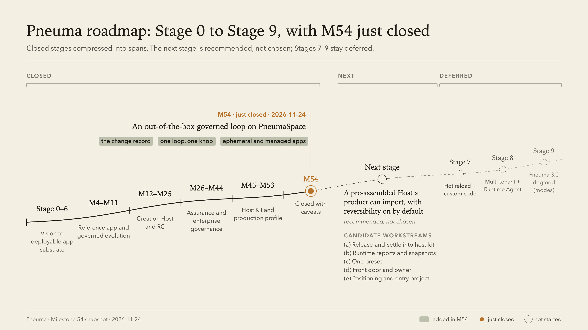

# Milestone 54 Snapshot: An out-of-the-box governed loop on PneumaSpace

**Milestone:** M54, An out-of-the-box governed loop on PneumaSpace
**Status:** Closed. The structural caveat stands: the pre-assembled Host is an example to copy, not a package to import (review verdict and closure conditions at the end of the Executive Summary).
**Date:** 2026-11-24
**Audience:** teammates with zero Pneuma context
**Scope:** both repositories, for the work of 2026-11-23 to 2026-11-24. The code state the milestone was verified at is pneuma-framework `5d2f1a5` and pneuma-space `6e73538` (main); the close-out paperwork commits sit on top of them. What the milestone proves, what it does not prove yet, and what should become the next phase.
**Chinese version:** [milestone-54-snapshot.zh-CN.md](./milestone-54-snapshot.zh-CN.md)

## Executive Summary

The two projects exist to answer one question, in the owner's words (working notes of 2026-11-23, kept outside this repository, not the root `CONTEXT.md` glossary): when agent coding is a basic capability that can be integrated into any agent product, how do we provide an out-of-the-box, agent-native infrastructure for it? Ordinary people can build their own apps with an agent, but they cannot do version control, change planning, persistence design or disaster recovery; the software should provide those as capabilities and presets. Before M54, pneuma-framework (auditable development) and pneuma-space (a light runtime for apps of this kind) did not reference each other, and every milestone proved the loop for a Developer assembling a Creation Host. M54 joins them in `examples/space-all-in-one`: one `docker compose` stack where any coding agent publishes small stateful apps on PneumaSpace and keeps changing them under the framework's governed loop. Underneath it, a new framework module, the change record, records every change with the guarantees that held, and an undo past a destructive change is backed by a declared data snapshot, confirmed by the owner, or refused. On 2026-11-24 a Codex session with no context went from an empty directory to a running app with stored data in 6 min 21 s, a second session stopped by itself at the owner's gate when asked to delete data, and the owner decided on a page written for a non-programmer (pandazki/pneuma-framework#17). The structural caveat: the pre-assembled Host exists as an example to copy, not as a package to import.

```text
any coding agent in the app directory          a product that starts the agent itself
  edits in place, then                            bun run drive change <app> "<intent>"
  node .pneuma/pneuma.mjs submit "<intent>"         --agent codex|claude-code|scripted
                 \                                  /
                  -> Host: writable roots, protected paths, npm test, preview (ephemeral app)
                  -> preset decides: policy:auto approves, or the owner decides (page or terminal)
                  -> release on PneumaSpace as a managed app
                  -> change record: version, intent, agent, guarantees that held, one-way mark
                  -> undo: code always; stored data only through a declared capability;
                     past a one-way change only with the owner's confirmation
```

The key shift:

| Before this milestone | After this milestone |
|---|---|
| The two repositories did not reference each other. | One compose stack runs PneumaSpace and a Host built on the framework's loop. |
| Every milestone proved the loop for a Developer assembling a Creation Host. | A coding agent with no context creates, changes and hands over an app; the owner sees, decides and goes back without being a programmer. |
| The lightest use of the framework needed a verify command, a risk policy and an approval record. | `record` mode records everything and checks nothing; `personal` and `review-all` write to the same record. |
| ADR-0017 promised that data flows back on rollback; only code went back, and an undo after an approved column drop reported success while every signed-in request answered 500. | An undo past a one-way change is refused, confirmed by the owner, or backed by a data snapshot the Host declares, and the entry says which. |
| Previews were Host workarounds (a temporary name, then remove and purge), and the PneumaSpace console could act behind the Host. | PneumaSpace ends previews itself (ephemeral apps) and refuses writes that do not name the app's manager (managed apps). |

Review verdict:

| Question | Verdict |
|---|---|
| Q1 alignment | **Yes, with one structural caveat.** For: M54 is the first proof of the first half of the vision line (the solo individual), and the record reads as a history a person can follow. Against: layer 3 exists as an example to copy, not as something to import. `examples/space-all-in-one/src/host.ts` is 2338 lines; host-kit's `governed-change.ts` is 210 and `change-record.ts` 914. The release-and-settle logic (publish, probe, put the address back, what serves now, previews) lives in the example. Five review rounds kept finding defects in exactly that code and did not converge, because the example Host infers facts the runtime owns (what serves, whether a version started). So "out of the box" is proven for a person with a Claude Code or Codex subscription, and only shown by reference for the Developer who integrates it into an agent product. |
| Q2 thoughtfulness | Uneven by phase; see the "How it was done" column of the [Appendix](#appendix--historical-slice-ledger). All of it happened in about 26 hours (2026-11-23 14:09 to 2026-11-24 about 16:30 JST). Several failure paths are covered by tests and not by a live run; `test:k8s`, the hosted and the multi-replica suites of PneumaSpace were not rerun. |
| Q3 closure | **Close with caveats.** This milestone's own process artefacts were never committed. At the owner's request the close-out also moved the older process plans and design specs under `docs/superpowers/` (78 files, M2 to M49) into git history; the commit that removed them lists each file with the commit to read it from. |

Closure conditions the review set for the paperwork, each met in this close-out:

1. Done: ADR-0039 is `Accepted` (2026-11-24), its text synced to the code (`check?`, `one_way_crossed`, `discarded_edits`, `kept_edits`, five `record` commands); it states what it supersedes in ADR-0017 (destructive rollback with data flowing back, never implemented) and ADR-0016 (its line that rollback is destructive), and both carry "superseded in part" status notes.
2. Done: canonical docs present `v0.5.0` (tagged) as the current release and M54 as closed in `[Unreleased]`, no longer 0.4.0 / M53; no tag or version bump was made, since cutting a release is the owner's decision.
3. Done: README and the site's governed-loop page now state the declared-reversibility model; the site's rollback concept page keeps its code-only text, now scoped by a note to the clean-room Host, which declares no capability.
4. Done: the undecided items from section 三 of those working notes are in `OPEN-QUESTIONS.md` ("Product Questions After M54") and in the [Team Decision Gate](#team-decision-gate).
5. Done: pneuma-space's README has a "What builds on it" section that points at pneuma-framework's `space-all-in-one`.

## Milestone Thesis

> ***One governed loop, with one knob, now runs out of the box on a runtime built for these apps: an agent with no context can create, change and hand over an app, and the person who owns it can see, decide and go back without being a programmer.***

- **Yes, proven for:** the individual with a coding agent (agent-driven), and a product that starts the agent itself (host-driven), over the same app directory and one history.
- **Not an importable Host:** layer 3 is not a package for integrators yet. An integrator copies the example.
- **Not multi-user or hosted operation:** everything ran on one machine with one unauthenticated owner.
- **Not data that always comes back on undo:** stored data comes back only when the Host declares a data snapshot capability, and the first-run stack declares none.

## Where Pneuma Sits

Pneuma aims to be **the open-source infrastructure an agent product embeds so that the apps its users build by talking get versions, change review and a way back as defaults**, preset by a Developer for a scenario and a cost, instead of learned by the user. It is three layers agreed on 2026-11-23: PneumaSpace is the runtime, the framework's loop kernel is governance, and a pre-assembled headless Host joins the two by a preset. Layer 3 did not exist before this milestone.

Neighbours are described by category, in general terms; individual products differ.

| | Hosted app builder that owns the whole stack | Coding agent used directly with a PaaS | Version control plus CI | **Pneuma at M54** |
|---|---|---|---|---|
| Who drives | Typically the builder's own built-in agent | The person's own coding agent | Whoever commits: a person or an agent | **Any coding agent working in the app directory (Claude Code and Codex run live), or a product that starts the agent itself** |
| What is recorded | The platform's own project history, kept by the platform | The agent's session and the platform's deploy log, kept apart | Commits and CI results | **Every attempt, in the app directory: what was asked, by which agent, the guarantees that held, one-way marks** |
| Who decides risky changes | The platform's flow and the user | The agent's permission prompts and the person | Reviewers and branch rules a team sets up | **A preset file: `policy:auto` approves ordinary changes, the owner decides risky ones on a page or in a terminal** |
| What undo covers | Set by the platform | Redeploying an earlier build; stored data depends on the database service | Reverting code; stored data is outside its scope | **Code to any earlier version on its chain; stored data only when the Host declares a capability; past a one-way change only with the owner's confirmation** |
| Where it runs | The vendor's cloud | The platform's cloud | Wherever the team deploys | **PneumaSpace on the person's own machine, one compose stack; hosted paths not rerun** |

Three differentiators, each traceable to a decision:

1. **One record under every mode.** Versions and an append-only history live in the app directory; governance writes the guarantees that held into the same entries, so a recorded-only version is never mistaken for a checked one. ([ADR-0039](../architecture/adr/0039-change-record-floor-and-declared-reversibility.md) §1, §2, §5)
2. **Reversibility is declared, not promised.** A destructive change is legitimate when authorised and is marked one-way; undo past it is refused unless the Host restores data through a capability it declares or the owner accepts the cost. ([ADR-0039](../architecture/adr/0039-change-record-floor-and-declared-reversibility.md) §3, §4)
3. **Runtime facts move to the runtime.** PneumaSpace ends previews itself and refuses writes that bypass an app's manager, so the Host stops working around them. ([space ADR 0038](https://github.com/pandazki/pneuma-space/blob/main/docs/adr/0038-ephemeral-apps.md), [space ADR 0039](https://github.com/pandazki/pneuma-space/blob/main/docs/adr/0039-managed-apps.md))

## System At A Glance

The architectural insight of this milestone: **two control planes and three layers meet in one place, the app directory, which carries the protocol, the record and the Host's address, so any agent or any Host can continue it.**


```text
 coding agent (Claude Code, Codex)            agent product (host-driven)
 edits + `node .pneuma/pneuma.mjs submit`     `bun run drive change` starts the agent on a draft
            |                                              |
            v                                              v
 +------------------------- apps/<name>/ (the artifact) -------------------------+
 | AGENTS.md, CLAUDE.md   pneuma.scaffold.json   pneuma-space.json   src/ public/ |
 | .pneuma/: pneuma.mjs  host.json  versions/vN/  history.jsonl  record.json      |
 +--------------------------------------------------------------------------------+
            |                                              ^
            v                                              |
 [3] Host  examples/space-all-in-one   NEW: owner page, JSON API, CLI, preset file
     PNEUMA_GOVERNANCE = record | personal | review-all     policy/personal.json
            | uses
 [2] framework  host-kit/change-record (NEW), host-kit/governed-change,
     core/enterprise-governance, core/release-rollout, core/build-thread,
     backend-claude-code (NEW), backend-codex
            | appctl publish --manager [--ephemeral --ttl], admin API
            v
 [1] PneumaSpace  gateway, runner, object store, redis (+ screenshot, optional postgres)
     NEW: ephemeral apps (ADR 0038), managed apps (ADR 0039), newest build writes (ADR 0040)
```

Layer 3 is what this milestone added: a Host with an owner page, a JSON API and a zero-dependency CLI that lives in every app directory. In layer 2 it added the change record and the Claude Code backend and reused the rest: the governed-change backbone (now with `writableRoots`, `walkOptions` and `sealDraft`), the governance evaluator (unchanged), the rollout state and the build thread. In layer 1 PneumaSpace gained three accepted ADRs. The Host keeps no state about an app; copying the directory to another machine and pointing any Host at it continues the same history (`test/host.test.ts`, "the directory alone is enough").

## What Is Proven

| Capability | Current proof |
|---|---|
| A no-context agent creates an app and publishes a change | #17 step A: empty directory to a running app with stored data in 6 min 21 s, 30 commands, no human input; `create` made v1, one `submit` published v2. |
| A returning agent splits a request and stops at the owner's gate | #17 step B: the search box went live as v3 under `policy:auto`; the column drop stopped at `needs_approval`; the agent did not try to approve and gave the owner the preview, the page link and the CLI command. |
| The owner decides on a page for a non-programmer | #17: before and after pictures, the checks, why the owner is asked; "go live" stays disabled until the owner ticks that the data cannot come back; v4 approved by `user:me`, marked ONE-WAY, channel `owner-page`. |
| Undo tells the truth past a one-way change | #17: v3's code does not start on the changed data; the Host puts the address back on v4 and records `restore rejected (published_unhealthy)`. Example README Status rows on undo; `test/host.test.ts` "one-way changes". |
| Data comes back when a Host declares the capability | Example README Status rows for the `postgres-template` practice: the dropped column and both earlier rows came back, the later row sat in the replaced database. Not in the no-context run. |
| One record, three modes | `record`, `personal`, `review-all` (`src/policy.ts` `GovernanceMode`); `test/host.test.ts` "record mode: the zero position of the dial"; README Status row on `record` mode. |
| Both control planes write one history | #17: v2 recorded as `codex [agent-driven]`, v5 as `codex [host-driven]` on the same app; `test/host.test.ts` "a host-driven turn and an agent-driven edit stack on the same app". |
| An agent can answer "what apps do I have?" | #17 step C: about 20 s, two commands (`list`, `status`), correct, including the refused undo. |
| Previews end themselves, and writes that skip the manager are refused | README Status rows of 2026-11-24 on ephemeral and managed apps; space ADR 0038, 0039. |
| The first-run frictions of the earlier trial did not come back | #17: ports and network solved from the README, the agent label right, `bun install --frozen-lockfile` not in the way, the gate counted the app's own tests (issues #4 to #10 from trial #3). |

## Current Primitive Surface

```text
change record   @pneuma-framework/host-kit/change-record   (framework, the floor)
  ├─ ChangeRecordEntry + guarantees: verified, previewed, approved, sealed
  ├─ one_way mark; restore refuses to cross it (crosses_one_way_change)
  └─ DataSnapshotCapability { snapshot, check?, restore } + restoreWithData
governance knob (Host)   record | personal | review-all;  risk preset policy/*.json
control planes (Host)    agent-driven: CLI submit  |  host-driven: drive change
runtime (PneumaSpace)    ephemeral apps | managed apps | upgrade writes go to the newest build
```

The record is the floor and promises only itself: a faithful copy per version, an append-only history, an exact restore of files. It runs no check, asks nobody, never touches stored data and does not lock. The governed modes are layers that write to the same record and name what held. The knob, the preset and both control planes belong to the Host, not to the framework (ADR-0039 §5). PneumaSpace runs whatever version the Host releases and now owns three facts the Host used to fake.

The entry and its guarantees (`packages/host-kit/src/change-record.ts`):

```ts
export const GUARANTEES = {
  verified: "verified",   // A check command passed on this content.
  previewed: "previewed", // This content answered as a running app before release.
  approved: "approved",   // An approval record exists for this content.
  sealed: "sealed",       // The recorded content is byte-identical to the content that was checked.
} as const;

export interface ChangeRecordEntry {
  readonly change_id: string;
  readonly at: string;
  readonly kind: string;                    // the floor writes "create" | "change" | "restore"
  readonly intent: string;                  // what the person asked for
  readonly agent: string;
  readonly version?: string;
  readonly base_version?: string;
  readonly changed_paths?: readonly string[];
  readonly guarantees: readonly string[];   // empty means recorded only
  readonly one_way?: OneWayChange;          // { reason }
  readonly data_ref?: DataRef;              // { capability, ref }
  readonly one_way_crossed?: OneWayCrossing; // { versions, by: "data_restored" | "accepted", data_ref? }
  readonly discarded_edits?: readonly string[];
  readonly kept_edits?: readonly string[];
}
```

The one-way rule and the declared capability:

```ts
export interface DataSnapshotCapability {
  readonly id: string; // e.g. "neon-branch"
  snapshot(input: { appRoot: string; version: string }): Promise<{ ref: string }>;
  check?(input: { appRoot: string; ref: string }): Promise<void>; // optional; changes nothing
  restore(input: { appRoot: string; ref: string }): Promise<void>;
}

export function restoreWithData<Extra = {}>(
  record: ChangeRecord,
  version: string,
  capability: DataSnapshotCapability | undefined,
  input: RestoreInput & { extra?: Extra },
  options: RestoreWithDataOptions = {}, // release, verify, putReleaseBack
): Promise<ChangeRecordEntry & Extra>;
```

The framework supplies no capability. Without one, an undo past a one-way change puts back code only and needs the caller's explicit `acceptOneWay`; the example Host asks the owner for it.

The three modes and the preset (`examples/space-all-in-one/src/policy.ts`):

```ts
export type GovernanceMode = "record" | "personal" | "review-all";

export interface RiskPolicy {
  readonly preset_id: string;
  readonly auto_approve: readonly BuildChangeRisk[]; // risks the standing policy may approve
  readonly change: {
    readonly risk: BuildChangeRisk;
    readonly when_only_under: readonly { readonly paths: readonly string[]; readonly risk: BuildChangeRisk; readonly note?: string }[];
  };
  readonly paths: readonly PathRule[];
  readonly manifest: readonly ManifestRule[]; // capability_added, capability_removed, runtime_changed, sign_in_dropped
  readonly content: readonly ContentRule[];   // text patterns over changed files; may carry one_way
}
```

| Mode | What happens before a version is recorded |
|---|---|
| `record` | Nothing checked, everything recorded and published. Entries say `guarantees: []`. Undo past a one-way change still needs the owner. |
| `personal` (default) | Writable roots, protected paths, `npm test`, and a preview always run. `policy:auto` approves what the preset's `auto_approve` lists; the owner decides the rest. |
| `review-all` | The same checks; the owner approves every change. |

In the governed modes the rule is "no approval record, no change". `policy/personal.json` (`space-isolate-personal`) auto-approves `additive_ui`, `source_code_change`, `definition_additive` and `release_change`; dropping sign-in (`policy_change`) and destructive SQL (`destructive_definition`, `one_way: true`) wait for the owner.

The two control planes:

| Plane | How it is driven | Recorded as |
|---|---|---|
| Agent-driven | The agent edits the app directory and runs `node .pneuma/pneuma.mjs submit "<what was asked>"`; `AGENTS.md` opens with the protocol. | The detected agent, e.g. `codex [agent-driven]`, with `agent_source` |
| Host-driven | `bun run drive change <app> "<intent>" --agent codex\|claude-code\|scripted` starts the agent on a draft. | e.g. `codex [host-driven]` |

The runtime side, in PneumaSpace:

| Primitive | What it does |
|---|---|
| Ephemeral apps (ADR 0038) | An app published with `--ephemeral --ttl` gets an end time at its first publish and ends itself; it has its own stores, access fixed to `tenant`, no cron, and its own `ephemeral` quota. `discard` ends it in one call and takes an `?app=<id>` precondition. The Host uses it for previews. |
| Managed apps (ADR 0039) | An app can name its manager. Writes to it that do not carry `X-Pneuma-Space-Manager: <name>` answer 409, from the admin API, `appctl` and the console alike. A guard against mistakes, not a security boundary. |
| Upgrade write rule (ADR 0040) | During a rolling upgrade, management writes and the leader lock go to the newest gateway build; an older replica answers 503 with `Retry-After`. No effect with one replica. |

## Working Definition Surface

What the app directory owns. The Host keeps no state about an app (example README, "The artifact").

| Path | What it is |
|---|---|
| `AGENTS.md`, `CLAUDE.md` | How to work on the app: the change protocol first, then the PneumaSpace guide. |
| `pneuma-space.json` | What the runtime must provide (capabilities). |
| `pneuma.scaffold.json` | The framework's `ScaffoldProjectManifest`: writable roots, protected paths, the checks that gate a change. |
| `.pneuma/pneuma.mjs` | Zero-dependency CLI that talks to a Host. |
| `.pneuma/host.json` | The Host's address, written by the Host. |
| `.pneuma/versions/vN/` | Clean source of every recorded version (the change record). |
| `.pneuma/history.jsonl` | One line per attempt with the guarantees that held. The Host adds its own fields: outcome, risks, approval, checks, address, `channel`, `confirmed_by`, `agent_source`. |
| `.pneuma/record.json` | The change record's version counter and current version. |
| `.pneuma/build-threads.json` | The framework's BuildThread transcript. |
| `.pneuma/release-rollout.json` | The framework's rollout state: what the address serves. |

The record lives where the coding agent works, and the agent can write any line of it. It is a history for people and agents, not an authority: a Host checks what it reads from it before acting with privileges the agent does not have, such as the `ref` a capability restores ([Change Record](../developer/change-record.md), "The Record Is Not An Authority").

## Supported Operations / Mutations

The CLI: `create`, `submit`, `status`, `history`, `list`, `approve`, `deny`, `undo`, `preview`, `discard`, `guide`. The Host records its own address in the app directory, names the detected agent in each entry, and sends a `pneuma-host-api` level header (now 2) so an old Host and a new CLI do not talk past each other. Three operations carry the loop. Signatures are from `examples/space-all-in-one/src/host.ts` (`AppHost`):

```ts
submit(input: SubmitInput): Promise<ChangeResult>
// SubmitInput: { name, intent, agent, agentProvenance?, oneWay? /* record mode only */, runAgent? /* host-driven */ }
resolve(name: string, changeId: string, answer: "approved" | "denied", subject: string, reason?: string, channel?: string): Promise<ChangeResult>
undo(name: string, reason: string, options: UndoOptions = {}): Promise<UndoResult>
// UndoOptions: { actor?, to?, acceptOneWay?, subject?, channel?, from? /* the plan that was shown */ }
```

Acceptance, from the no-context run (#17):

| Operation | Before | What was done | After |
|---|---|---|---|
| `submit` | v2 current | A returning Codex session submitted the search box; writable roots, protected paths, `npm test` and a preview ran, as always in `personal`. | v3 live under `policy:auto`. The column drop, submitted separately, waits as `needs_approval`. |
| `resolve` (page) | The column drop waits; the disclosure says the data cannot come back. | The owner ticked the confirmation and let it go live. | v4 published, approved by `user:me`, marked ONE-WAY, channel `owner-page`. |
| `undo` past one-way (page) | v4 current; no capability declared | The owner went back to v3 and confirmed a second time. | v3's code answered `GET /` with 500; the address went back to v4, the current version stayed v4, `restore rejected (published_unhealthy)` recorded. |
| `undo`, plain (page) | v5 current | The owner went back one version. | v4 current, recorded as `restore rolled_back`. |

## End-To-End Loop


```text
 intent ("add a search box")
   |
 1 agent edits apps/<name>/ in place        (host-driven: drive change runs the agent on a draft)
   |
 2 submit: the Host copies the tree and diffs it against what the address serves
   |        outside the writable roots, or a protected path -> rejected, nothing released
 3 checks: npm ci --ignore-scripts && npm test in a copy outside the app; the draft is sealed by hash
   |
 4 preview: an ephemeral app <app>-pv…, own empty stores, ends itself (PNEUMA_PREVIEW_TTL, default 3600 s)
   |
 5 preset classifies the risks -> policy:auto approves | needs_approval -> owner (page or terminal)
   |                                                     one-way: a second confirmation about stored data
 6 release on PneumaSpace as a managed app; the address is probed
   |        one-way and a capability declared: the data snapshot is taken first
 7 change record: vN, intent, agent, guarantees [verified, previewed, approved, sealed], one_way
   |
 8 undo: plan -> refusals (+ capability check) -> older code out -> data back -> probe -> record moves
```

What happens in the run is not hidden in the UI. Each step maps to a concept:

| Moment in the run | Concept |
|---|---|
| Codex opens the app directory, reads `AGENTS.md`, runs `status` and `history`, then `submit` | Self-describing artifact; the agent calls the Host through the CLI in the directory |
| A protected-path edit answered `rejected (protected_file_changed)` (README Status) | `buildGovernedProposal` with protected paths and `writableRoots` (`host-kit/governed-change`) |
| The preview link the agent hands to the owner | A PneumaSpace ephemeral app (space ADR 0038) |
| v3 goes live with no person asked | `policy:auto` in the framework's `BuildChangeGovernancePolicy`; the preset's `auto_approve` |
| The column drop stops at `needs_approval` with a disclosure | Preset rule `destructive-sql` with `one_way: true`; the owner role |
| The owner ticks "the data cannot come back" and approves on the page | Owner link; the entry's `one_way` and `channel: owner-page` |
| `restore rejected (published_unhealthy)`, address back on v4 | `undo` with the owner's confirmation and no capability; the release probe; the rollout state |
| v5 recorded as `codex [host-driven]` | `@pneuma-framework/backend-codex` through `drive change` |

## Demo Story

The demo is the run in pandazki/pneuma-framework#17, on `5d2f1a5` with PneumaSpace `6e73538`:

```text
cd examples/space-all-in-one
docker compose up -d --build
node bin/pneuma.mjs create <app>
open http://127.0.0.1:8090/                    # the owner page
docker compose logs host | grep "owner link"   # the link that may decide
```

1. **First run:** a Codex session with no context, in an empty directory, found its own project name, network and ports from the README, created v1 and published v2 with one `submit`, in 6 min 21 s with no human input.
2. **Returning change:** a second session, opened in the app directory, put the search box live as v3 under `policy:auto` and stopped the data deletion at `needs_approval`, handing the owner the preview, the page link and the command.
3. **The owner decides:** on the page, before and after pictures, the checks and the reason; after ticking that the data cannot come back, the owner let it go live as v4, marked ONE-WAY.
4. **Ask and delegate:** a third session answered "how many apps do I have, and is anything waiting?" with `list` and `status` in about 20 s, and a host-driven Codex turn published v5 in 64 s.
5. **Going back:** going back past the one-way change was refused by the health probe because v3's code cannot read today's data, and the address returned to v4, as declared; a plain go-back from v5 to v4 worked. (In the run the one-way attempt came before step 4.)

The click-by-click route is the example README ("Run it (agent-driven)", "Run it (host-driven)", "Your apps page, the owner link, and the PneumaSpace console"). The run's four frictions are in #17.

## Rollback / Reversibility Path

An undo is planned on the change record and executed through `restoreWithData`, in this order (`packages/host-kit/src/change-record.ts`):

```text
undo.validate
  -> planRestore(target): undone versions, one-way entries among them, dataRef
  -> refusals: unknown version, unsaved edits, plan_changed (Host), a one-way crossing
     that is neither data-restored nor accepted -> crosses_one_way_change
  -> capability.check(ref), when data is to be put back -> data_snapshot_refused
     (nothing has been touched yet)

undo.prepare
  -> the owner confirms (terminal or page); the confirmation names the case and the snapshot
  -> release: the target's code goes out on PneumaSpace (code before data, so the build
     that dropped the data never starts on restored data)

undo.execute
  -> capability.restore(ref), when declared and planned
  -> verify: the app has to answer
  -> the record moves by the plan step 1 made; the entry says data_restored or accepted
  failure after release: the address goes back to what served, or, once data is back,
  the newer code is not put back and the record names what is in place
```

| Rollback impact | Status |
|---|---|
| Code of any earlier version on the current version's chain (`undo`, `undo --to`) | Supported (change record); run live and in #17 |
| Undo past a one-way change, no capability declared | Refused until the owner confirms; then code only. In #17 the older code did not start on today's data and the address went back to v4. |
| Undo past a one-way change, `postgres-template` practice | Supported as a practice for apps whose database is on PostgreSQL: data returns to the snapshot, what was stored since is set aside in a renamed database (README Status) |
| Apps on SQLite, and files, key-value data and objects | Not covered |
| The default first-run stack | Declares no capability |
| Ending snapshots and replaced databases | Not supported: nothing ends them, and they block purging the app (#14) |
| A snapshot at PneumaSpace's release quiescent point for files plus SQLite | Not built; next-phase workstream (b) |

## Why These Design Choices

Three decisions do most of the load-bearing work. A reviewer who pushes back will push back on one of these.

### 1. The record is the floor; governance is a layer on the same record

Versions and history are a module that does not depend on governance and promises only the record. The governed loop writes the guarantees that held into each entry.

**Why:** the lightest use, one person and their own coding agent, needs only "a version per change and a way back". One record then serves from the individual to the enterprise, and a reader can always tell what was guaranteed about a version. A "skip everything" switch on the governed loop would have produced records shaped like checked ones. ([ADR-0039](../architecture/adr/0039-change-record-floor-and-declared-reversibility.md), Option C, §1, §2, §5)

**Cost:** one more concept; a `record`-only release can break a running app, by definition; versions are directory copies with no deduplication; there is no lock; and the record is writable by the agent, so it is not an authority.

### 2. Reversibility is declared, not promised

A destructive change can be released when authorised and is marked one-way. An undo past it is refused, unless the Host restored data through a `DataSnapshotCapability` it declares, or the caller explicitly accepts the cost.

**Why:** the framework does not own storage; a framework-level promise that data comes back would be impossible or would bind a storage backend (Option D1), and forbidding destructive changes would forbid evolution (Option D2). The record always tells the truth, and the promise is made by the party able to keep it. ([ADR-0039](../architecture/adr/0039-change-record-floor-and-declared-reversibility.md), Option D3, §3, §4, §6)

**Cost:** a Host that declares no capability cannot bring an earlier version's data back after a destructive change. The first-run stack declares none, so the default path says truthfully that data does not come back. A snapshot taken only before a one-way change drops what was written after it.

### 3. No bypass: the approver becomes a standing policy, and the rules are a preset

The personal path does not skip approval. It keeps "no approval record, no change" and lets a subject, `policy:auto`, satisfy the low-risk routes; risky routes require the owner. Which change carries which risk is a JSON preset the Host is started with, not code.

**Why:** it is expressible with the framework's existing governance model (`BuildChangeGovernancePolicy`, `evaluateBuildChangeGovernance`, unchanged). The verify gate and the preview are not permissions, so they run in both governed modes. A Developer can preset the rules by scenario and cost. (Example README, "Governance: one record, one dial"; ADR-0039 §5)

**Cost:** the shipped SQL rules are text patterns; they stop a quoted `DROP` that never runs and miss a deletion built from variables. The preset covers build time only; run-time presets (PneumaSpace Policy, tenant quota) are a separate half. On one machine the owner is a name, not an authenticated principal.

## M54 Verification Matrix

Columns are how each capability was verified: the offline tests (`bun test`; PneumaSpace is an in-memory fake and the agent CLIs are scripted), the live runs of 2026-11-23/24 recorded in the example README's Status table (39 rows) and its "Not run live" list, and the no-context end-to-end run of 2026-11-24 (#17).

| Capability | Unit / integration tests | Live run earlier in the milestone (README) | No-context e2e, 2026-11-24 (#17) | Notes |
|---|:-:|:-:|:-:|---|
| Create | ✅ | ✅ | ✅ | about 14 s live; v1 in #17 step A |
| Change auto-approved | ✅ | ✅ | ✅ | v2 and v3 under `policy:auto` in #17 |
| Risky change waits | ✅ | ✅ | ✅ | column drop at `needs_approval`; the agent did not approve |
| Owner approves on page | ✅ | ✅ | ✅ | `owner.test.ts`; README row "Deciding on the page"; v4 by `user:me` |
| Undo, plain | ✅ | ✅ | ✅ | v21 to v19 one step at a time and `--to v16` live; v5 to v4 in #17 |
| Undo past one-way, no data snapshot | ✅ | ✅ | ✅ | earlier live run: the refusal only, the owner's confirmation was not run live; #17: confirmed on the page, refused by the probe, address back on v4 |
| Undo with data snapshot | ✅ | ✅ | — | `postgres-template` on PostgreSQL; its integration test runs only with `PNEUMA_TEST_POSTGRES_URL`; not exercised in #17 |
| Preview as ephemeral app | ✅ | ✅ | — | #17 reports a preview handed to the owner, not its end |
| Managed refusal | ✅ | ✅ | — | Host side tested against the in-memory PneumaSpace; not exercised in #17 |
| List across apps | ✅ | ✅ | ✅ | two commands, about 20 s in #17 |
| Host-driven lane | ✅ | ✅ | ✅ | `scripted`, `claude-code`, `codex` live; Codex 64 s, v5 in #17 |
| Agent label | ✅ | ✅ | ✅ | markers of two agents give `unknown` with candidates; #17 labels right |

Legend: ✅ a source records it passing · ❌ a source records it failing (none) · — not recorded for that method.

Targeted suite, from the framework repository root:

```text
bun install --frozen-lockfile
bun run typecheck
bun run test:packages
bun test examples/space-all-in-one
bun test packages/host-kit/test/change-record.test.ts
bun test packages/cli/test/record.test.ts
bun run test:package-consumption
```

From the pneuma-space repository root:

```text
npm run test:unit
npm run test:docker        # needs Docker
npm run test:acceptance
```

Repo state (2026-11-24):

```text
pneuma-framework 5d2f1a5  CI offline gate: pass (bun install --frozen-lockfile, typecheck, package tests,
                          bun test examples/space-all-in-one, package consumption)
                          full bun test on the head of PR #16 before its merge, run during the
                          follow-up work and not written in a PR body: 1849 pass, 2 skip, 0 fail
pneuma-space 6e73538      npm run test:unit, rerun by the reviewer on the #42 branch before
                          merging it: 612 pass, 1 skip, 0 fail
                          docker: 122/122, acceptance: 64/64 (as stated by the PR author)
                          test:k8s: not run; hosted and multi-replica suites: not rerun
```

## Project Progress By Layer

### Qualitative

| Layer | Status | Current state | Implication |
|---|---|---|---|
| Runtime (PneumaSpace) | 🟡 Partial | Ephemeral apps, managed apps and the upgrade write rule are accepted and merged. It does not report what serves, takes no snapshot at release, and under `local` mode its admin API accepts cross-site writes (space #43). | The Host still infers runtime facts; the cheap snapshot path is unused. |
| Governance kernel (framework packages) | 🟡 Partial | The change record and the new `buildGovernedProposal` options are in host-kit with their own tests. Release-and-settle (publish, probe, put the address back, previews) is not. | Every integrator inherits that logic from the example. |
| Pre-assembled Host (the example) | 🟡 Partial | Runs end to end on one machine and passed the no-context run. It is an example to copy; `src/host.ts` is 2338 lines, and review findings clustered there without converging. | Layer 3 is shown by reference, not importable. |
| Owner surface (page and CLI) | 🟡 Partial | Page and CLI decide through the same gates and write the same entries; English and Chinese. The owner is not authenticated, and a failed go-back shows the Host's raw words (#17 friction 4). | Usable by one person on a trusted machine; a product brings its own login. |
| Presets | 🟡 Partial | Three modes and a risk preset file with `one_way` rules. Build-time presets (framework Profile, policy file) and run-time presets (PneumaSpace Policy, tenant quota) are still two halves. | A Developer cannot yet preset one scenario in one place. |
| Positioning | ❌ | Positioning, naming, packaging and promotion have not started; the entry project was deferred by the owner on 2026-11-23. | The engineering can now carry that discussion. |

### ADR coverage (by §)


ADR-0039 is `Accepted` (2026-11-24). It was `Proposed` at `5d2f1a5` and was accepted in this close-out, with its text synced to the code. Coverage means the decision exists, a code path implements it, and at least one test or live run exercises it.

| § | Topic | Status | Notes |
|---|---|---|---|
| §1 | Change record | ✅ Full | Module, layout and promises as written; `change-record.test.ts`; the example is on it. |
| §2 | Each entry says what was guaranteed | ✅ Full | `GUARANTEES`; the example writes them per its README table. The ADR's entry type now matches the code (`one_way_crossed`, `discarded_edits`, `kept_edits`). |
| §3 | One-way changes | ✅ Full | Preset `one_way`, `--one-way` in `record` mode, three outcomes; run live and in #17. |
| §4 | Data restore is a Host-declared capability | 🟡 Partial | Interface, `restoreWithData` and one practice landed, and the ADR now states `check?` and the `restoreWithData` order. Partial because the first-run stack declares no capability and nothing ends snapshots (#14). |
| §5 | Governance on the same record, three-position knob | ✅ Full | In the example. The `unattendedDeploy` line in `CLAUDE.md` and `AGENTS.md` now names a record-only mode as that explicit authorisation. |
| §6 | Effect on ADR-0017 and ADR-0016 | ✅ Full | ADR-0039 states what it supersedes; ADR-0017 and ADR-0016 carry "superseded in part by ADR-0039" status notes, their text unchanged. |
| §7 | Not in this decision (`shadow-git`) | — n/a | Out of scope by decision. |
| — | ADR-0039 follow-ups | ✅ Done | `CLAUDE.md` / `AGENTS.md` principle 6 and the `unattendedDeploy` line, the readiness review item (shadow-git now PARTIAL), and the `OPEN-QUESTIONS.md` entries. |

PneumaSpace ADRs:

| ADR | Status | Notes |
|---|---|---|
| [0038 Ephemeral apps](https://github.com/pandazki/pneuma-space/blob/main/docs/adr/0038-ephemeral-apps.md) | ✅ Accepted 2026-11-24 | The Host's previews; run live (README Status). |
| [0039 Managed apps](https://github.com/pandazki/pneuma-space/blob/main/docs/adr/0039-managed-apps.md) | ✅ Accepted 2026-11-24 | Every release and preview names the Host; run live. The name is not a credential. |
| [0040 Upgrade writes go to the newest build](https://github.com/pandazki/pneuma-space/blob/main/docs/adr/0040-upgrade-writes-newest-build.md) | ✅ Accepted 2026-11-24 | Checked by the PR author with two gateways; no effect on the single-replica example stack; `test:k8s` not run. |

Visual roll-up:

```text
ADR-0039 §1 change record             ▰▰▰▰▰▰▰▰▰▰  Full
ADR-0039 §2 guarantees per entry      ▰▰▰▰▰▰▰▰▰▰  Full
ADR-0039 §3 one-way changes           ▰▰▰▰▰▰▰▰▰▰  Full
ADR-0039 §4 declared data restore     ▰▰▰▰▰▰▱▱▱▱  Partial (none declared by default; nothing ends snapshots, #14)
ADR-0039 §5 one record, one knob      ▰▰▰▰▰▰▰▰▰▰  Full
ADR-0039 §6 ADR-0017/0016 superseded  ▰▰▰▰▰▰▰▰▰▰  Full
ADR-0039 follow-ups                   ▰▰▰▰▰▰▰▰▰▰  Done
space ADR 0038 / 0039 / 0040          ▰▰▰▰▰▰▰▰▰▰  Accepted
```

## What This Does Not Prove Yet

The milestone is real, but it is not yet a product an integrator imports, nor a promise an ordinary person can rely on for their data.

| Not yet proven | Why it matters |
|---|---|
| Layer 3 as a package | There is no importable pre-assembled Host; an integrator copies the example, and with it the logic review rounds did not converge on. |
| Data on undo by default | The first-run stack declares no snapshot capability. PneumaSpace's cheap path (immutable releases, a quiescent point at release, files plus SQLite) is not used; only a PostgreSQL template-database practice exists, and nothing ends its snapshots (#14). |
| A real owner | On one machine the owner is not authenticated. `approve` asks a terminal and the page asks for a link the agent could read. It is documented as a speed bump. |
| The runtime's own front door | Under `local` mode the PneumaSpace admin API accepts cross-site writes from any web page (space #43); the screenshot browser's filter has known holes (WebSocket, frames from another site). |
| One preset surface | Build-time presets (framework Profile, policy file) and run-time presets (PneumaSpace Policy, tenant quota) are still two halves. |
| Other agents and scale | Claude Code was run live earlier in the milestone but not in the final e2e; multi-user, hosted and Kubernetes paths were not rerun. |
| Paths the runs did not reach | `deny` on the page and Codex's default sandbox (#17); a whole Linux machine and the gateway without the Docker socket (README "Not run live"). |
| The second half of the original ask | Positioning, naming (the term "agent native" is in use elsewhere for a different idea), packaging and promotion have not started. |
| Reuse across apps | "Similar apps should not need the same requirements twice": the record is the raw material; nothing derives preferences from it yet. |

## Strategic Read

The worry is not the loop, it is where the loop lives. The example Host carries the logic the framework should own: publishing, probing, putting the address back, knowing what serves now, previews. Review findings cluster there and do not converge, because the Host infers facts the runtime owns. Every integrator who copies the example would inherit that. The next milestone should move release-and-settle into host-kit and have the runtime report the facts the Host now infers.

"Cannot be broken" is honest today but thin. The default path says truthfully that data does not come back: a one-way change is marked, the owner is told the cost, and an undo that cannot work is refused rather than reported as a success. For ordinary people the promise only becomes real when a snapshot at release is the default on the default storage.

The product question is open while the engineering is ahead of it: one product or two, who the first design partner is, and what the entry project is. The engineering can now carry that discussion; it could not a week ago.

## Recommended Next Phase



> **Make layer 3 real: a pre-assembled Host a product can import, with reversibility on by default.**

Candidate workstreams (see [`roadmap.md`](../architecture/roadmap.md)):

| Workstream | Goal |
|---|---|
| (a) Release-and-settle into host-kit | Release-and-settle and preview move into host-kit; the example Host shrinks to wiring. |
| (b) Runtime reports and snapshots | PneumaSpace reports what serves and takes a snapshot at the release quiescent point for files plus SQLite. |
| (c) One preset | One preset that spans build time and run time. |
| (d) Front door and owner | Close the local front door (space #43) and decide the owner's identity on one machine. |
| (e) Positioning and entry project | The owner's call; deferred by the owner on 2026-11-23. |

Constraint for the next stage: no new product surface inside the example until (a) is done.

## Team Decision Gate

For the team share, end with these decisions:

1. Do we accept that the integrator story is "copy the example" for now, and make "import a Host" the next milestone?
2. Is one product with two layers (PneumaSpace as the entry, the governed loop as the layer on top) the outward shape, or do the two stay separate products?
3. Do we promise "undo brings your data back" by default, which commits PneumaSpace to snapshots at release?
4. Is there a first design partner, and is it an individual-developer audience or an agent-product team?

Also undecided, from section 三 of the owner's working notes and recorded nowhere in the repositories until this close-out: the second half of the original ask (positioning, packaging, promotion; the earlier ordering was made before reading the code and needs a second pass against the run results); the name, since "agent native" is in use elsewhere for a different idea; and the owner's identity on one machine.

If the team agrees, the project has a clean phase boundary:

```text
Milestone 54:
  "Can an agent with no context create, change and hand over an app on a runtime built
   for these apps, with the owner able to see, decide and go back without being a programmer?"
  Answer: yes, for one person with a coding agent on one machine, and for a product that
  starts the agent, by copying the example.

Next milestone:
  "Can an agent product import a pre-assembled Host, with undo bringing data back by default?"
  Answer: next work.
```

## Evidence

Merged pull requests:

| Repo | PR | Merge commit | Merged (UTC) |
|---|---|---|---|
| pneuma-framework | #2 | `157f973` | 2026-11-23 12:05 |
| pneuma-framework | #11 | `7ddcb3d` | 2026-11-24 06:36 |
| pneuma-framework | #12 | `50d20b3` | 2026-11-24 06:36 |
| pneuma-framework | #13 | `d504ddb` | 2026-11-24 06:36 |
| pneuma-framework | #15 | `e4e74b5` | 2026-11-24 06:37 |
| pneuma-framework | #16 | `5d2f1a5` | 2026-11-24 07:32 |
| pneuma-space | #37 | `9bf5396` | 2026-11-23 17:35 |
| pneuma-space | #38 | `c7ba4c4` | 2026-11-23 17:36 |
| pneuma-space | #39 | `85014ce` | 2026-11-23 17:35 |
| pneuma-space | #40 | `53e3f45` | 2026-11-24 06:02 |
| pneuma-space | #42 | `6e73538` | 2026-11-24 07:23 |

Issues:

| Issue | State | What it is |
|---|---|---|
| pneuma-framework #3 | Closed | First no-context trial (2026-11-23); filed #4 to #10 and pneuma-space #35, #36. |
| pneuma-framework #4 to #10 | Closed | First-run frictions; closed by #12, #13 and #15. |
| pneuma-space #35, #36 | Closed | Template tests and managed apps; answered by space #38 and #39. |
| pneuma-framework #14 | Open | Nothing ends a data snapshot; no way to ask whether a capability covers an app. |
| pneuma-framework #17 | Open | The no-context run of 2026-11-24 and its four frictions. |
| pneuma-space #41 | Open | Four small items from the #37/#39 review fixes. |
| pneuma-space #43 | Open | Cross-site writes to the admin API under `local` mode. |

Recent commits leading into this snapshot (pneuma-framework):

```text
5d2f1a5 Merge pull request #16 from pandazki/fix/review-followups-13-15
9ff6fc3 chore(examples/space-all-in-one): pin PneumaSpace at 6e73538
b372976 fix(examples/space-all-in-one): the preview's words the live run showed
5369811 docs(examples/space-all-in-one): say what the screenshot browser filters and what it does not
29d06ea fix(examples/space-all-in-one): going back is tied to the plan that was shown
781acf4 fix(examples/space-all-in-one): only an owner is named as approver
e9e43f7 fix(examples/space-all-in-one): a preview PneumaSpace said nothing about is unknown
ab844a6 fix(examples/space-all-in-one): a preview PneumaSpace refuses is not a failed check
3fd11c9 fix(examples/space-all-in-one): the Host counts and discards only its own preview
```

Verification commands: the targeted suite in the [Verification Matrix](#m54-verification-matrix), and the live route in the example README.

Latest recorded full test state:

```text
pneuma-framework, full bun test on the head of PR #16 (9ff6fc3, same tree as 5d2f1a5) before its merge: 1849 pass, 2 skip, 0 fail
pneuma-space, npm run test:unit rerun by the reviewer on the #42 branch before merging it: 612 pass, 1 skip, 0 fail
```

## Reading Path

For a teammate with no context:

1. Read this snapshot.
2. Read [`examples/space-all-in-one/README.md`](../../examples/space-all-in-one/README.md): Status, "Governance: one record, one dial", "One-way changes and undo", and "Gaps this example found".
3. Read [ADR-0039](../architecture/adr/0039-change-record-floor-and-declared-reversibility.md) and [Change Record](../developer/change-record.md).
4. Read the two trial reports, pandazki/pneuma-framework#3 and #17, then [`OPEN-QUESTIONS.md`](../architecture/OPEN-QUESTIONS.md) and [`roadmap.md`](../architecture/roadmap.md).

For deeper architecture, follow [`docs/architecture/README.md`](../architecture/README.md) into the ADR set.

## Appendix — Historical Slice Ledger

| Slice | Durable result | How it was done (review verdict Q2) |
|---|---|---|
| pneuma-framework #2 | `examples/space-all-in-one` (two control planes, risk preset file, self-describing app directory), `@pneuma-framework/backend-claude-code`, `backend-codex` on the current app-server protocol, `buildGovernedProposal` gains `walkOptions`, `writableRoots`, `sealDraft`; a gap list per repository. | Deliberate about boundaries: no change to PneumaSpace in that round, gaps written down per repo. The Host grew by accretion. |
| pneuma-framework #11 | ADR-0039 and `@pneuma-framework/host-kit/change-record`; `pneuma-framework record`; the example on the record with three modes, multi-level undo, one-way rules, and the `postgres-template` practice. | Deliberate: ADR first, a framework-level contract in host-kit with its own tests, one loop with one knob, reversibility as something a Host declares. Loose ends at merge: the ADR was still `Proposed`, its text had drifted from the code, and its follow-ups were not done; all three are closed in this close-out. |
| pneuma-framework #12 | Fixes for trial #3 (#4 to #10): the Host records its address, `list` and the apps-directory guide, the agent label and its source, test coverage in the check, browser-request refusal, a read-only overview page. | Reactive, but driven by a real no-context trial, which is the right source. |
| pneuma-space #37 | ADR 0038 ephemeral apps: discard, expiry, own quota, access fixed to `tenant`, no cron. | Part of the best pattern of the milestone: a fact moved to the layer that owns it. |
| pneuma-space #38 | The template's `npm test` runs the app's own tests; the handler moves to `src/app.ts`. | Answers trial #3 (space #35). |
| pneuma-space #39 | ADR 0039 managed apps: writes must name the manager (`X-Pneuma-Space-Manager`), in the console too. | Same pattern: the runtime refuses writes that do not name the manager. |
| pneuma-space #40 | Review follow-ups to #37 and #39: quota fields default instead of unlimited, bounded audit on failed expiry, discard precondition `?app=<id>`, manager header rules. | Review round. |
| pneuma-framework #13 | Previews as ephemeral apps, releases as managed apps; pin at `c7ba4c4`; Host API level 2; the Host's test-script patch (`coverAppTests`) deleted. | The best pattern of the milestone: a fact moved to the layer that owns it (the runtime ends previews, the runtime refuses writes that do not name the manager). The Host dropped its workarounds (the preview list, remove-and-purge cleanup, the test-script patch), though `src/host.ts` ended 46 lines longer, because republishing a preview and claiming the manager came in (PR #13). |
| pneuma-framework #15 | The owner page at `/`: app cards with pictures, a waiting change as before and after, history in plain words, going back, ⌘K search, English and Chinese; owner link; `screenshot` service. | Fast, one day, redone once for looks; security was reviewed; it is product surface living in an example. |
| pneuma-space #42 | ADR 0040: during a rolling upgrade, management writes and the lead go to the newest gateway build. | Merged on CI and the author's live checks; `test:k8s` not run. |
| pneuma-framework #16 | Review follow-ups to #13 and #15 (only this Host's standing preview counts and is discarded, `preview_refused` and `preview_unknown`, only an owner named as approver, undo tied to the shown plan); pin at `6e73538`. | Merged on CI and the author's live checks without a full review round, by the owner's decision. |
