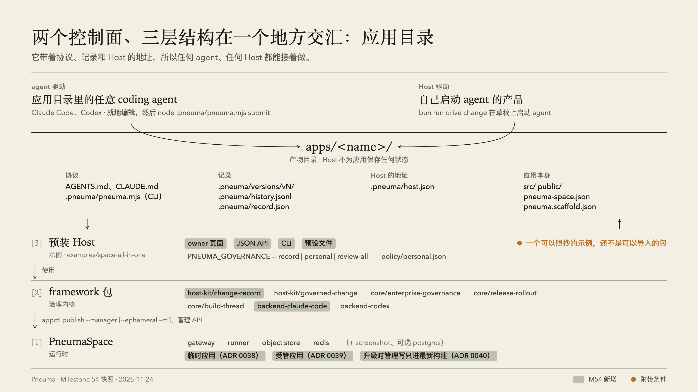
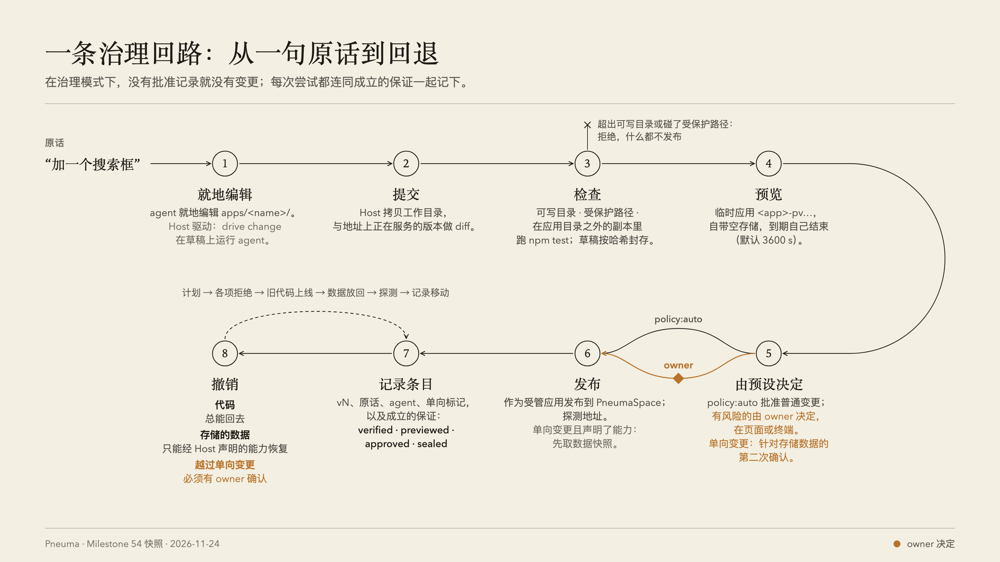
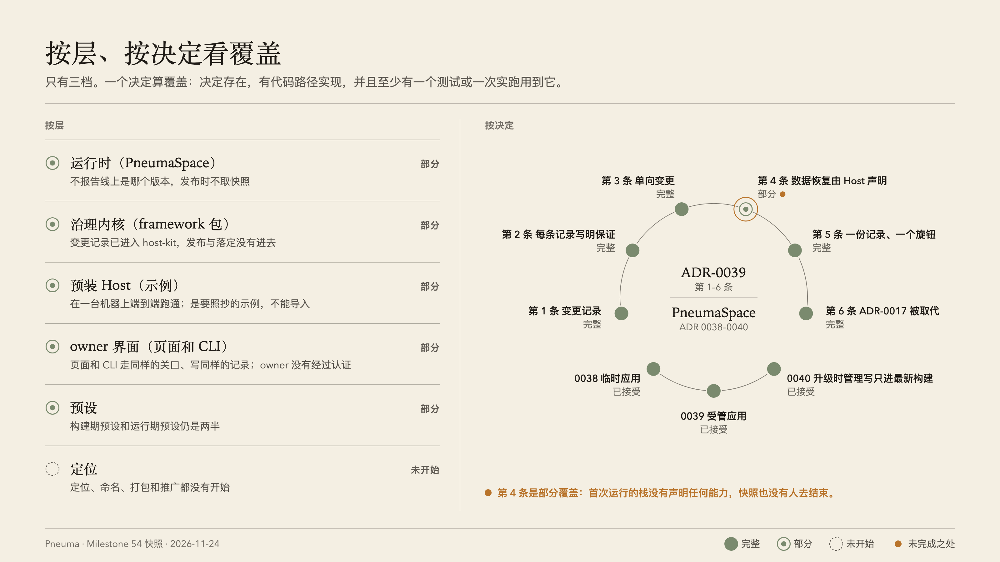
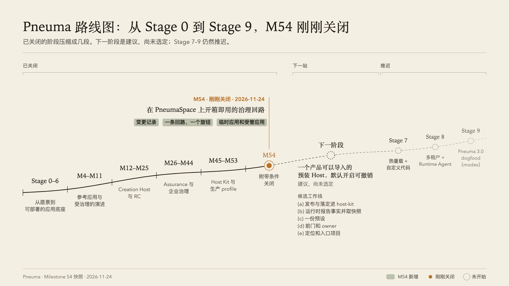

# Milestone 54 快照：在 PneumaSpace 上开箱即用的治理回路

**Milestone:** M54，An out-of-the-box governed loop on PneumaSpace
**状态：** 已关闭。结构性的附带条件仍然成立：预装 Host 是一个要照抄的示例，不是可导入的包（评审结论和关闭条件见"概要"末尾）。
**日期：** 2026-11-24
**读者：** 对 Pneuma 没有任何背景的同事
**范围：** 两个仓库，覆盖 2026-11-23 至 2026-11-24 的工作。这个 milestone 验证时的代码状态是 pneuma-framework `5d2f1a5` 和 pneuma-space `6e73538`（均为 main）；收尾文档的提交在它们之上。内容是：这个 milestone 证明了什么、还没有证明什么、下一阶段应该做什么。
**英文版：** [milestone-54-snapshot.md](./milestone-54-snapshot.md)

## 概要

两个项目要回答的是同一个问题，用 owner 自己的话说（`CONTEXT.md`，2026-11-23）："agent coding 作为基础能力，可以被集成到任意的 agent 产品下时，如何提供一个开箱即用的，agent native 的 infra"。普通人可以借助 agent 构建自己的应用，但做不了版本控制、变更规划、持久化设计和容灾，这些应该由软件作为能力和预设提供出来。M54 之前，pneuma-framework（可审计的开发框架）和 pneuma-space（面向这类应用的轻量运行时）互不引用，此前每个 milestone 证明的都是"Developer 自己组装 Creation Host"时回路成立。M54 在 `examples/space-all-in-one` 里把两者接起来：一个 `docker compose` 栈，任意 coding agent 都能在 PneumaSpace 上发布带状态的小应用，并在 framework 的治理回路下持续修改。它的底下是 framework 新增的一个模块：变更记录。每次变更都连同"哪些保证成立"一起记下；越过破坏性变更的撤销，要么有 Host 声明的数据快照兜底，要么经 owner 确认，否则被拒绝。2026-11-24，一个没有任何上下文的 Codex 会话从空目录出发，6 分 21 秒得到一个带存储数据、正在运行的应用；第二个会话被要求删除数据时，自己停在了 owner 的关口前；owner 在一个为非程序员写的页面上做了决定（pandazki/pneuma-framework#17）。结构性的附带条件是：预装好的 Host 目前是一个可以照抄的示例，还不是一个可以导入的包。

```text
应用目录里的任意 coding agent                自己启动 agent 的产品
  就地编辑，然后                              bun run drive change <app> "<intent>"
  node .pneuma/pneuma.mjs submit "<intent>"     --agent codex|claude-code|scripted
                 \                                  /
                  -> Host：可写目录、受保护路径、npm test、预览（临时应用）
                  -> 由预设决定：policy:auto 批准，或由 owner 决定（页面或终端）
                  -> 作为受管应用发布到 PneumaSpace
                  -> 变更记录：版本、原话、agent、成立的保证、单向标记
                  -> 撤销：代码总能回去；存储的数据只能经 Host 声明的能力恢复；
                     越过单向变更必须有 owner 确认
```

关键变化：

| 这个 milestone 之前 | 这个 milestone 之后 |
|---|---|
| 两个仓库互不引用。 | 一个 compose 栈同时跑 PneumaSpace 和基于 framework 回路的 Host。 |
| 每个 milestone 证明的都是 Developer 自己组装 Creation Host 时回路成立。 | 没有上下文的 coding agent 能创建、修改、交接一个应用；owner 不必是程序员，也能看到、决定、回退。 |
| 最轻的用法也得提供 verify 命令、风险策略和批准记录。 | `record` 模式记录一切、什么都不检查；`personal` 和 `review-all` 写的是同一份记录。 |
| ADR-0017 承诺回滚时数据一起倒流，实际只回代码；一次被批准的删列之后，撤销报告成功，每个登录用户的请求却都返回 500。 | 越过单向变更的撤销要么被拒绝，要么经 owner 确认，要么由 Host 声明的数据快照兜底，记录写明是哪一种。 |
| 预览靠 Host 绕路实现（临时名字，再 remove 和 purge），PneumaSpace 控制台可以背着 Host 操作应用。 | PneumaSpace 自己结束预览（临时应用），并拒绝不点名管理方的写操作（受管应用）。 |

评审结论：

| 问题 | 结论 |
|---|---|
| Q1 方向是否一致 | **是，但有一个结构性的附带条件。** 支持的一面：M54 第一次证明了愿景那句话的前半句（个人用户），记录读起来是一段人能跟得上的历史。反对的一面：第三层是一个可照抄的示例，不是可导入的东西。`examples/space-all-in-one/src/host.ts` 有 2338 行，而 host-kit 的 `governed-change.ts` 是 210 行、`change-record.ts` 是 914 行。发布与落定的逻辑（发布、探测、把地址放回去、当前线上是哪个版本、预览）都在示例里。五轮评审在这段代码里反复发现问题且没有收敛，因为示例 Host 在推断本该由运行时掌握的事实（线上是哪个版本、某个版本有没有起来）。所以"开箱即用"对有 Claude Code 或 Codex 订阅的个人是证明了的，对要把它集成进 agent 产品的 Developer，只是给出了参考实现。 |
| Q2 是否经过深思 | 各阶段不一样，见文末附录的"做法"一列。全部工作在大约 26 小时内完成（东京时间 2026-11-23 14:09 至 2026-11-24 约 16:30）。若干失败路径有测试覆盖，但没有实跑；PneumaSpace 的 `test:k8s`、托管和多副本测试套件没有重跑。 |
| Q3 是否关闭 | **带附带条件关闭。** 这个 milestone 自己的过程文档从未提交。按 owner 的要求，这次关闭同时把 `docs/superpowers/` 下更早的过程计划和设计稿（78 个文件，M2 到 M49）移进了 git 历史；删除它们的那个提交列出了每个文件以及从哪个提交读取。 |

评审为这批文档定下的关闭条件，都已在这次收尾中完成：

1. 已完成：ADR-0039 已是 `Accepted`（2026-11-24），正文与代码对齐（`check?`、`one_way_crossed`、`discarded_edits`、`kept_edits`、`record` 的五条命令）；它写明了取代 ADR-0017 的什么（带数据倒流的破坏性回滚，从未实现）和 ADR-0016 的什么（"回滚是破坏性的"那一句），两份 ADR 都加了"部分被取代"的状态说明。
2. 已完成：规范文档把 `v0.5.0`（已打 tag）当作当前版本，把 M54 写成已关闭、在 `[Unreleased]` 里，不再把 0.4.0 / M53 当作现状；没有打 tag，也没有改版本号，是否发版由 owner 决定。
3. 已完成：README 和站点的 governed-loop 页面改为"可撤销范围靠声明"的模型；站点的 rollback 概念页保留"只回代码"的正文，但加了一段说明，限定它讲的是没有声明能力的 clean-room Host。
4. 已完成：`CONTEXT.md` 第三部分里尚未决定的事已写进 `OPEN-QUESTIONS.md`（"Product Questions After M54"）和下文的"团队决策关口"。
5. 已完成：pneuma-space 的 README 加了 "What builds on it" 一节，指向 pneuma-framework 的 `space-all-in-one`。

## Milestone 主张

> ***一条治理回路、一个旋钮，现在可以在为这类应用打造的运行时上开箱即用：没有上下文的 agent 能创建、修改、交接一个应用，拥有它的人不必是程序员，也能看到、决定、回退。***

- **证明了的：** 用 coding agent 的个人（agent 驱动），以及自己启动 agent 的产品（Host 驱动），两者作用于同一个应用目录、同一段历史。
- **不是可导入的 Host：** 第三层还不是给集成方的包，集成方要照抄示例。
- **不是多用户或托管运行：** 一切都在一台机器上、由一个未经认证的 owner 完成。
- **不是撤销时数据总能回来：** 只有 Host 声明了数据快照能力，存储的数据才会回来；首次运行的栈没有声明。

## Pneuma 的位置

Pneuma 想做的是**一套开源基础设施，嵌进 agent 产品之后，用户靠对话做出来的应用默认就有版本、变更审查和回退的路**。这些由 Developer 按场景和成本预设好，而不是让用户去学。它分三层，2026-11-23 定下：PneumaSpace 是运行时，framework 的回路内核负责治理，一个预装好的无界面 Host 按一份预设把两者接起来。第三层在这个 milestone 之前不存在。

下表按类别、用笼统的说法描述相邻方案，具体产品各有不同。

| | 自管全栈的托管式应用构建平台 | 直接用 coding agent 加 PaaS | 版本控制加 CI | **M54 时的 Pneuma** |
|---|---|---|---|---|
| 谁在驱动 | 通常是平台自带的 agent | 用户自己的 coding agent | 提交代码的人或 agent | **在应用目录里工作的任意 coding agent（实跑过 Claude Code 和 Codex），或自己启动 agent 的产品** |
| 记录了什么 | 平台自己的项目历史，由平台保存 | agent 的会话和平台的部署日志，分开保存 | 提交和 CI 结果 | **每一次尝试，存在应用目录里：要了什么、哪个 agent、成立的保证、单向标记** |
| 谁决定有风险的变更 | 平台的流程和用户 | agent 的权限提示和用户本人 | 团队设置的评审人和分支规则 | **一份预设文件：`policy:auto` 批准普通变更，有风险的由 owner 在页面或终端决定** |
| 撤销覆盖什么 | 由平台决定 | 重新部署更早的构建；存储的数据取决于数据库服务 | 回退代码；存储的数据不在它的范围内 | **代码可以回到版本链上任意更早的版本；数据只在 Host 声明能力时回来；越过单向变更必须有 owner 确认** |
| 在哪里运行 | 供应商的云 | 平台的云 | 团队部署到哪里就在哪里 | **用户自己机器上的 PneumaSpace，一个 compose 栈；托管路径没有重跑** |

三个差异点，每一个都对应一个决定：

1. **所有模式下面是同一份记录。** 版本和只追加的历史放在应用目录里；治理把成立的保证写进同一批记录，所以"只被记录"的版本永远不会被误认为"被检查过"。（[ADR-0039](../architecture/adr/0039-change-record-floor-and-declared-reversibility.md) 第 1、2、5 条）
2. **可撤销范围靠声明，不靠承诺。** 破坏性变更在授权下可以发布，并标成单向；越过它的撤销会被拒绝，除非 Host 通过自己声明的能力恢复了数据，或 owner 接受代价。（[ADR-0039](../architecture/adr/0039-change-record-floor-and-declared-reversibility.md) 第 3、4 条）
3. **运行时的事实交给运行时。** PneumaSpace 自己结束预览，并拒绝绕过管理方的写操作，Host 不再为这些绕路。（[space ADR 0038](https://github.com/pandazki/pneuma-space/blob/main/docs/adr/0038-ephemeral-apps.md)、[space ADR 0039](https://github.com/pandazki/pneuma-space/blob/main/docs/adr/0039-managed-apps.md)）

## 系统一览

这个 milestone 的架构要点：**两个控制面、三层结构在一个地方交汇，就是应用目录。它带着协议、记录和 Host 的地址，所以任何 agent、任何 Host 都能接着做。**



```text
 coding agent (Claude Code, Codex)            agent product (host-driven)
 edits + `node .pneuma/pneuma.mjs submit`     `bun run drive change` starts the agent on a draft
            |                                              |
            v                                              v
 +------------------------- apps/<name>/ (the artifact) -------------------------+
 | AGENTS.md, CLAUDE.md   pneuma.scaffold.json   pneuma-space.json   src/ public/ |
 | .pneuma/: pneuma.mjs  host.json  versions/vN/  history.jsonl  record.json      |
 +--------------------------------------------------------------------------------+
            |                                              ^
            v                                              |
 [3] Host  examples/space-all-in-one   NEW: owner page, JSON API, CLI, preset file
     PNEUMA_GOVERNANCE = record | personal | review-all     policy/personal.json
            | uses
 [2] framework  host-kit/change-record (NEW), host-kit/governed-change,
     core/enterprise-governance, core/release-rollout, core/build-thread,
     backend-claude-code (NEW), backend-codex
            | appctl publish --manager [--ephemeral --ttl], admin API
            v
 [1] PneumaSpace  gateway, runner, object store, redis (+ screenshot, optional postgres)
     NEW: ephemeral apps (ADR 0038), managed apps (ADR 0039), newest build writes (ADR 0040)
```

第三层是这个 milestone 新加的：一个 Host，带 owner 页面、JSON API，以及一个放在每个应用目录里、零依赖的 CLI。第二层新加了变更记录和 Claude Code 后端，其余是复用的：受治理变更的主干（新增了 `writableRoots`、`walkOptions`、`sealDraft`）、治理判定（未改动）、发布状态和 BuildThread。第一层 PneumaSpace 新增了三份已接受的 ADR。Host 不为应用保存任何状态；把目录拷到另一台机器、让任意一个 Host 指向它，历史就接着往下走（`test/host.test.ts`，"the directory alone is enough"）。

## 已证明的能力

| 能力 | 当前证据 |
|---|---|
| 没有上下文的 agent 创建应用并发布一次变更 | #17 步骤 A：从空目录到带存储数据、正在运行的应用，6 分 21 秒，30 条命令，无人介入；`create` 生成 v1，一次 `submit` 发布 v2。 |
| 回来接着改的 agent 会拆开请求，并停在 owner 的关口前 | #17 步骤 B：搜索框以 v3 上线，由 `policy:auto` 批准；删列停在 `needs_approval`；agent 没有尝试批准，把预览、页面链接和 CLI 命令交给了 owner。 |
| owner 在为非程序员写的页面上做决定 | #17：改动前后的截图、做过的检查、为什么要问 owner；勾选"数据回不来"之前，"上线"按钮一直不可用；v4 由 `user:me` 批准，标为 ONE-WAY，渠道 `owner-page`。 |
| 越过单向变更时，撤销说真话 | #17：v3 的代码在改过的数据上起不来；Host 把地址放回 v4，并记下 `restore rejected (published_unhealthy)`。示例 README 状态表里关于撤销的几行；`test/host.test.ts` "one-way changes"。 |
| Host 声明了能力，数据就能回来 | 示例 README 状态表里 `postgres-template` 实践的几行：被删的列和之前的两行数据回来了，之后写入的那行在被替换下来的数据库里。无上下文实跑没有覆盖。 |
| 一份记录，三种模式 | `record`、`personal`、`review-all`（`src/policy.ts` 的 `GovernanceMode`）；`test/host.test.ts` "record mode: the zero position of the dial"；README 状态表里 `record` 模式那一行。 |
| 两个控制面写同一段历史 | #17：同一个应用上，v2 记为 `codex [agent-driven]`，v5 记为 `codex [host-driven]`；`test/host.test.ts` "a host-driven turn and an agent-driven edit stack on the same app"。 |
| agent 能回答"我有哪些应用" | #17 步骤 C：约 20 秒，两条命令（`list`、`status`），回答正确，包括那次被拒绝的撤销。 |
| 预览自己结束，不点名管理方的写操作被拒绝 | README 状态表里 2026-11-24 关于临时应用和受管应用的几行；space ADR 0038、0039。 |
| 上一次试跑暴露的首次运行摩擦没有再出现 | #17：端口和网络从 README 里自己解决，agent 标签正确，`bun install --frozen-lockfile` 不再碍事，检查统计到了应用自己的测试（来自试跑 #3 的 #4 至 #10）。 |

## 当前原语面

```text
change record   @pneuma-framework/host-kit/change-record   (framework, the floor)
  ├─ ChangeRecordEntry + guarantees: verified, previewed, approved, sealed
  ├─ one_way mark; restore refuses to cross it (crosses_one_way_change)
  └─ DataSnapshotCapability { snapshot, check?, restore } + restoreWithData
governance knob (Host)   record | personal | review-all;  risk preset policy/*.json
control planes (Host)    agent-driven: CLI submit  |  host-driven: drive change
runtime (PneumaSpace)    ephemeral apps | managed apps | upgrade writes go to the newest build
```

记录是最底层，只承诺它自己：每个版本是忠实副本，历史只追加，恢复时文件逐个复原。它不跑检查、不问任何人、从不碰存储的数据、不加锁。治理模式是写在同一份记录上的上层，并在记录里写明哪些保证成立。旋钮、预设和两个控制面都属于 Host，不属于 framework（ADR-0039 第 5 条）。PneumaSpace 运行 Host 发布的任何版本，现在还接管了三件过去由 Host 模拟的事实。

记录条目和保证（`packages/host-kit/src/change-record.ts`）：

```ts
export const GUARANTEES = {
  verified: "verified",   // A check command passed on this content.
  previewed: "previewed", // This content answered as a running app before release.
  approved: "approved",   // An approval record exists for this content.
  sealed: "sealed",       // The recorded content is byte-identical to the content that was checked.
} as const;

export interface ChangeRecordEntry {
  readonly change_id: string;
  readonly at: string;
  readonly kind: string;                    // the floor writes "create" | "change" | "restore"
  readonly intent: string;                  // what the person asked for
  readonly agent: string;
  readonly version?: string;
  readonly base_version?: string;
  readonly changed_paths?: readonly string[];
  readonly guarantees: readonly string[];   // empty means recorded only
  readonly one_way?: OneWayChange;          // { reason }
  readonly data_ref?: DataRef;              // { capability, ref }
  readonly one_way_crossed?: OneWayCrossing; // { versions, by: "data_restored" | "accepted", data_ref? }
  readonly discarded_edits?: readonly string[];
  readonly kept_edits?: readonly string[];
}
```

单向规则和声明的能力：

```ts
export interface DataSnapshotCapability {
  readonly id: string; // e.g. "neon-branch"
  snapshot(input: { appRoot: string; version: string }): Promise<{ ref: string }>;
  check?(input: { appRoot: string; ref: string }): Promise<void>; // optional; changes nothing
  restore(input: { appRoot: string; ref: string }): Promise<void>;
}

export function restoreWithData<Extra = {}>(
  record: ChangeRecord,
  version: string,
  capability: DataSnapshotCapability | undefined,
  input: RestoreInput & { extra?: Extra },
  options: RestoreWithDataOptions = {}, // release, verify, putReleaseBack
): Promise<ChangeRecordEntry & Extra>;
```

framework 不提供任何能力实现。没有能力时，越过单向变更的撤销只放回代码，并且需要调用方显式传 `acceptOneWay`；示例 Host 会为此向 owner 要确认。

三种模式和预设（`examples/space-all-in-one/src/policy.ts`）：

```ts
export type GovernanceMode = "record" | "personal" | "review-all";

export interface RiskPolicy {
  readonly preset_id: string;
  readonly auto_approve: readonly BuildChangeRisk[]; // risks the standing policy may approve
  readonly change: {
    readonly risk: BuildChangeRisk;
    readonly when_only_under: readonly { readonly paths: readonly string[]; readonly risk: BuildChangeRisk; readonly note?: string }[];
  };
  readonly paths: readonly PathRule[];
  readonly manifest: readonly ManifestRule[]; // capability_added, capability_removed, runtime_changed, sign_in_dropped
  readonly content: readonly ContentRule[];   // text patterns over changed files; may carry one_way
}
```

| 模式 | 记录一个版本之前发生什么 |
|---|---|
| `record` | 什么都不检查，全部记录并发布。记录写 `guarantees: []`。越过单向变更的撤销仍然要 owner 确认。 |
| `personal`（默认） | 可写目录、受保护路径、`npm test` 和预览每次都跑。预设 `auto_approve` 里列出的风险由 `policy:auto` 批准，其余由 owner 决定。 |
| `review-all` | 检查相同；每次变更都由 owner 批准。 |

在两个治理模式下，规则是"没有批准记录，就没有变更"。`policy/personal.json`（`space-isolate-personal`）自动批准 `additive_ui`、`source_code_change`、`definition_additive` 和 `release_change`；取消登录要求（`policy_change`）和破坏性 SQL（`destructive_definition`，`one_way: true`）要等 owner。

两个控制面：

| 控制面 | 怎么驱动 | 记录成 |
|---|---|---|
| agent 驱动 | agent 编辑应用目录，运行 `node .pneuma/pneuma.mjs submit "<what was asked>"`；`AGENTS.md` 开头就是这套协议。 | 检测到的 agent，例如 `codex [agent-driven]`，附 `agent_source` |
| Host 驱动 | `bun run drive change <app> "<intent>" --agent codex\|claude-code\|scripted` 在草稿上启动 agent。 | 例如 `codex [host-driven]` |

运行时一侧，PneumaSpace：

| 原语 | 作用 |
|---|---|
| 临时应用（ADR 0038） | 用 `--ephemeral --ttl` 发布的应用在首次发布时定下结束时刻，到期自己结束；有自己的存储，访问固定为 `tenant`，不排 cron，单独计 `ephemeral` 配额。`discard` 一次调用结束它，可带前置条件 `?app=<id>`。Host 用它做预览。 |
| 受管应用（ADR 0039） | 应用可以点名自己的管理方。对它的写请求不带 `X-Pneuma-Space-Manager: <name>` 就答 409，管理 API、`appctl` 和控制台都一样。这是防误操作的护栏，不是安全边界。 |
| 升级时的写入规则（ADR 0040） | 滚动升级期间，管理写和领导锁只归最新的网关构建；旧副本答 503 并带 `Retry-After`。单副本时不起作用。 |

## 定义面：应用目录拥有什么

Host 不为应用保存任何状态（示例 README，"The artifact"）。

| 路径 | 是什么 |
|---|---|
| `AGENTS.md`、`CLAUDE.md` | 怎样在这个应用上工作：先是变更协议，后面是 PneumaSpace 的指南。 |
| `pneuma-space.json` | 运行时必须提供什么（能力）。 |
| `pneuma.scaffold.json` | framework 的 `ScaffoldProjectManifest`：可写目录、受保护路径、把关变更的检查。 |
| `.pneuma/pneuma.mjs` | 和 Host 通信的零依赖 CLI。 |
| `.pneuma/host.json` | Host 的地址，由 Host 写入。 |
| `.pneuma/versions/vN/` | 每个已记录版本的干净源码（变更记录）。 |
| `.pneuma/history.jsonl` | 每次尝试一行，带成立的保证。Host 加上自己的字段：结果、风险、批准、检查、地址、`channel`、`confirmed_by`、`agent_source`。 |
| `.pneuma/record.json` | 变更记录的版本计数器和当前版本。 |
| `.pneuma/build-threads.json` | framework 的 BuildThread 记录。 |
| `.pneuma/release-rollout.json` | framework 的发布状态：地址上跑的是哪个版本。 |

记录放在 coding agent 工作的目录里，agent 能写它的任何一行。它是给人和 agent 读的历史，不是权威：Host 在用 agent 没有的权限做事之前，必须先检查从记录里读到的东西，比如能力要恢复的那个 `ref`（[变更记录](../developer/change-record.zh-CN.md)，"记录不是权威"一节）。

## 支持的操作

CLI：`create`、`submit`、`status`、`history`、`list`、`approve`、`deny`、`undo`、`preview`、`discard`、`guide`。Host 把自己的地址记在应用目录里，在每条记录里写上检测到的 agent，并在每个响应里带 `pneuma-host-api` 级别头（现在是 2），避免旧 Host 和新 CLI 各说各话。撑起回路的是下面三个操作，签名取自 `examples/space-all-in-one/src/host.ts`（`AppHost`）：

```ts
submit(input: SubmitInput): Promise<ChangeResult>
// SubmitInput: { name, intent, agent, agentProvenance?, oneWay? /* record mode only */, runAgent? /* host-driven */ }
resolve(name: string, changeId: string, answer: "approved" | "denied", subject: string, reason?: string, channel?: string): Promise<ChangeResult>
undo(name: string, reason: string, options: UndoOptions = {}): Promise<UndoResult>
// UndoOptions: { actor?, to?, acceptOneWay?, subject?, channel?, from? /* the plan that was shown */ }
```

验收证据，取自无上下文实跑（#17）：

| 操作 | 之前 | 做了什么 | 之后 |
|---|---|---|---|
| `submit` | 当前是 v2 | 回来接着改的 Codex 会话提交了搜索框；可写目录、受保护路径、`npm test` 和预览照常在 `personal` 模式下运行。 | v3 上线，由 `policy:auto` 批准。删列被单独提交，停在 `needs_approval`。 |
| `resolve`（页面） | 删列在等待；披露写明数据回不来。 | owner 勾选确认，让它上线。 | v4 发布，由 `user:me` 批准，标为 ONE-WAY，渠道 `owner-page`。 |
| 越过单向变更的 `undo`（页面） | 当前是 v4；没有声明能力 | owner 回到 v3，并做第二次确认。 | v3 的代码对 `GET /` 返回 500；地址放回 v4，当前版本仍是 v4，记下 `restore rejected (published_unhealthy)`。 |
| 普通 `undo`（页面） | 当前是 v5 | owner 回退一个版本。 | 当前是 v4，记为 `restore rolled_back`。 |

## 端到端回路



```text
 原话（"加一个搜索框"）
   |
 1 agent 就地编辑 apps/<name>/          （Host 驱动：drive change 在草稿上运行 agent）
   |
 2 submit：Host 拷贝工作目录，与地址上正在服务的版本做 diff
   |        超出可写目录或碰了受保护路径 -> 拒绝，什么都不发布
 3 检查：在应用目录之外的副本里跑 npm ci --ignore-scripts && npm test；草稿按哈希封存
   |
 4 预览：临时应用 <app>-pv…，自带空存储，到期自己结束（PNEUMA_PREVIEW_TTL，默认 3600 s）
   |
 5 预设给风险分类 -> policy:auto 批准 | needs_approval -> owner（页面或终端）
   |                                     单向变更：针对存储数据的第二次确认
 6 作为受管应用发布到 PneumaSpace；探测地址
   |        单向变更且声明了能力：先取数据快照
 7 变更记录：vN、原话、agent、保证 [verified, previewed, approved, sealed]、one_way
   |
 8 撤销：计划 -> 各项拒绝（+ 能力的 check）-> 旧代码上线 -> 数据放回 -> 探测 -> 记录移动
```

实跑里发生的事并没有藏在界面后面，每一步都对应一个概念：

| 实跑中的时刻 | 对应概念 |
|---|---|
| Codex 打开应用目录，读 `AGENTS.md`，运行 `status` 和 `history`，然后 `submit` | 自描述的产物目录；agent 通过目录里的 CLI 调用 Host |
| 一次改受保护路径的提交得到 `rejected (protected_file_changed)`（README 状态表） | 带受保护路径和 `writableRoots` 的 `buildGovernedProposal`（`host-kit/governed-change`） |
| agent 交给 owner 的预览链接 | PneumaSpace 临时应用（space ADR 0038） |
| v3 上线，没有问任何人 | framework `BuildChangeGovernancePolicy` 里的 `policy:auto`；预设的 `auto_approve` |
| 删列停在 `needs_approval`，带披露 | 预设规则 `destructive-sql`，`one_way: true`；owner 角色 |
| owner 在页面上勾选"数据回不来"并批准 | owner 链接；记录里的 `one_way` 和 `channel: owner-page` |
| `restore rejected (published_unhealthy)`，地址放回 v4 | 带 owner 确认、没有能力的 `undo`；发布探测；发布状态 |
| v5 记为 `codex [host-driven]` | 经 `drive change` 调用的 `@pneuma-framework/backend-codex` |

## 演示故事

演示就是 pandazki/pneuma-framework#17 的那次实跑，framework `5d2f1a5`，PneumaSpace `6e73538`：

```text
cd examples/space-all-in-one
docker compose up -d --build
node bin/pneuma.mjs create <app>
open http://127.0.0.1:8090/                    # owner 页面
docker compose logs host | grep "owner link"   # 能做决定的那条链接
```

1. **首次运行：** 一个没有上下文的 Codex 会话在空目录里，从 README 自己找到项目名、网络和端口，创建 v1，一次 `submit` 发布 v2，用时 6 分 21 秒，无人介入。
2. **回来接着改：** 第二个会话在应用目录里打开，把搜索框以 v3 上线（`policy:auto`），把删数据的部分停在 `needs_approval`，并把预览、页面链接和命令交给 owner。
3. **owner 做决定：** 页面上有改动前后的截图、做过的检查和原因；owner 勾选"数据回不来"之后，让它以 v4 上线，标为 ONE-WAY。
4. **询问和委托：** 第三个会话用 `list` 和 `status` 在约 20 秒内回答了"我有几个应用、有没有在等我的"；一次 Host 驱动的 Codex 回合用 64 秒发布了 v5。
5. **回退：** 越过单向变更的回退被健康探测拒绝，因为 v3 的代码读不了现在的数据，地址回到 v4，与声明一致；从 v5 普通回退到 v4 成功。（实跑中越过单向变更的那次回退发生在第 4 步之前。）

逐步操作见示例 README 的 "Run it (agent-driven)"、"Run it (host-driven)" 和 "Your apps page, the owner link, and the PneumaSpace console"。这次实跑暴露的四处摩擦记在 #17。

## 回滚与可撤销路径

撤销在变更记录上做计划，经 `restoreWithData` 执行，顺序如下（`packages/host-kit/src/change-record.ts`）：

```text
undo.validate（校验）
  -> planRestore(target)：要撤销的版本、其中的单向记录、dataRef
  -> 各项拒绝：未知版本、未提交的改动、plan_changed（Host）、越过单向变更
     却既没恢复数据也没被接受 -> crosses_one_way_change
  -> 要放回数据时调用 capability.check(ref) -> data_snapshot_refused
     （到这里什么都还没动）

undo.prepare（准备）
  -> owner 确认（终端或页面）；确认文字写明是哪种情况、用哪份快照
  -> release：目标版本的代码在 PneumaSpace 上线（先代码后数据，
     删掉数据的那个构建不会在恢复后的数据上启动）

undo.execute（执行）
  -> 声明了能力且计划里有快照时，调用 capability.restore(ref)
  -> verify：应用必须应答
  -> 记录按第一步的计划移动；记录写 data_restored 或 accepted
  发布之后失败：地址放回原来服务的版本；如果数据已经放回，
  不会把新代码放回去，记录写当前实际在位的版本
```

| 回滚影响 | 状态 |
|---|---|
| 当前版本链上任意更早版本的代码（`undo`、`undo --to`） | 支持（变更记录）；实跑过，#17 也跑过 |
| 越过单向变更，没有声明能力 | owner 确认前拒绝；确认后只回代码。#17 中旧代码在现在的数据上起不来，地址回到 v4。 |
| 越过单向变更，`postgres-template` 实践 | 作为实践，支持数据库在 PostgreSQL 上的应用：数据回到快照，之后存下的内容放进改名后的数据库（README 状态表） |
| SQLite 上的应用，以及文件、键值数据和对象 | 不覆盖 |
| 默认的首次运行栈 | 没有声明能力 |
| 清理快照和被替换下来的数据库 | 不支持：没有任何东西结束它们，它们还会让应用无法被清除（#14） |
| 在 PneumaSpace 发布静止点为文件加 SQLite 取快照 | 未实现；下一阶段工作线 (b) |

## 为什么这样设计

三个决定承担了大部分分量。评审要反驳，多半会落在其中一个上。

### 1. 记录是底层，治理是同一份记录上的上层

版本和历史是一个不依赖治理的模块，只承诺记录本身。治理回路把成立的保证写进每条记录。

**原因：** 最轻的用法，一个人加上自己的 coding agent，只需要"每次改动一个版本，能回去"。同一份记录可以从个人一直用到企业，读者永远分得清一个版本被保证了什么。如果在治理回路上加一个"全部跳过"的开关，产出的记录会长得像被检查过一样。（[ADR-0039](../architecture/adr/0039-change-record-floor-and-declared-reversibility.md)，Option C，第 1、2、5 条）

**代价：** 多一个概念；只记录的发布按定义可能弄坏正在运行的应用；版本是目录副本，没有去重；没有锁；记录 agent 可写，所以它不是权威。

### 2. 可撤销范围靠声明，不靠承诺

破坏性变更在授权下可以发布，并标成单向。越过它的撤销会被拒绝，除非 Host 通过自己声明的 `DataSnapshotCapability` 恢复了数据，或者调用方明确接受代价。

**原因：** framework 不拥有存储；framework 级的"数据一定回来"要么做不到，要么把存储后端绑死（Option D1）；禁止破坏性变更等于禁止应用演进（Option D2）。记录永远说真话，承诺由有能力兑现的一方来做。（[ADR-0039](../architecture/adr/0039-change-record-floor-and-declared-reversibility.md)，Option D3，第 3、4、6 条）

**代价：** 没有声明能力的 Host，在破坏性变更之后回不到更早版本的数据。首次运行的栈没有声明，所以默认路径如实地说：数据回不来。只在单向变更之前取快照，意味着恢复会丢掉那之后写入的数据。

### 3. 不开旁路：批准人换成一条常设策略，规则放在预设里

个人路径不跳过批准。它保留"没有批准记录就没有变更"，由主体 `policy:auto` 满足低风险路由，高风险路由要求 owner。哪种变更带哪种风险，写在 Host 启动时读入的 JSON 预设里，不写在代码里。

**原因：** 这用 framework 现有的治理模型就能表达（`BuildChangeGovernancePolicy`、`evaluateBuildChangeGovernance`，都没有改）。verify 门和预览不是权限，所以两个治理模式下都跑。Developer 可以按场景和成本预设规则。（示例 README，"Governance: one record, one dial"；ADR-0039 第 5 条）

**代价：** 自带的 SQL 规则是文本匹配，会拦下一个从不执行、只出现在字符串里的 `DROP`，也会漏掉用变量拼出来的删除。预设只管构建期，运行期预设（PneumaSpace 的 Policy、租户配额）是另一半。单机上 owner 只是一个名字，不是经过认证的主体。

## M54 验证矩阵

列表示每项能力用什么方式验证：离线测试（`bun test`；PneumaSpace 用内存假实现，agent CLI 是脚本），示例 README 状态表（39 行）和"Not run live"清单记录的 2026-11-23/24 实跑，以及 2026-11-24 的无上下文端到端实跑（#17）。

| 能力 | 单元 / 集成测试 | milestone 早些时候的实跑（README） | 无上下文端到端，2026-11-24（#17） | 说明 |
|---|:-:|:-:|:-:|---|
| 创建 | ✅ | ✅ | ✅ | 实跑约 14 秒；#17 步骤 A 的 v1 |
| 变更自动批准 | ✅ | ✅ | ✅ | #17 中 v2、v3 由 `policy:auto` 批准 |
| 有风险的变更等待 | ✅ | ✅ | ✅ | 删列停在 `needs_approval`；agent 没有批准 |
| owner 在页面上批准 | ✅ | ✅ | ✅ | `owner.test.ts`；README "Deciding on the page" 那一行；v4 由 `user:me` 批准 |
| 普通撤销 | ✅ | ✅ | ✅ | 实跑中从 v21 一步步回到 v19，再 `--to v16`；#17 中 v5 回到 v4 |
| 越过单向变更，无数据快照 | ✅ | ✅ | ✅ | 早些时候的实跑只跑了拒绝，owner 确认没有实跑；#17：在页面上确认，被探测拒绝，地址回到 v4 |
| 带数据快照的撤销 | ✅ | ✅ | — | PostgreSQL 上的 `postgres-template`；它的集成测试只在设置 `PNEUMA_TEST_POSTGRES_URL` 时运行；#17 没有覆盖 |
| 预览作为临时应用 | ✅ | ✅ | — | #17 报告了交给 owner 的预览，没有报告它的结束 |
| 受管应用的拒绝 | ✅ | ✅ | — | Host 一侧用内存 PneumaSpace 测试；#17 没有覆盖 |
| 跨应用列出 | ✅ | ✅ | ✅ | #17 中两条命令，约 20 秒 |
| Host 驱动 | ✅ | ✅ | ✅ | 实跑 `scripted`、`claude-code`、`codex`；#17 中 Codex 64 秒，v5 |
| agent 标签 | ✅ | ✅ | ✅ | 同时有两个 agent 的标记时记为 `unknown` 并列出候选；#17 中标签正确 |

图例：✅ 有来源记录为通过 · ❌ 有来源记录为失败（无） · — 这种验证方式下没有记录。

定向测试，在 framework 仓库根目录：

```text
bun install --frozen-lockfile
bun run typecheck
bun run test:packages
bun test examples/space-all-in-one
bun test packages/host-kit/test/change-record.test.ts
bun test packages/cli/test/record.test.ts
bun run test:package-consumption
```

在 pneuma-space 仓库根目录：

```text
npm run test:unit
npm run test:docker        # needs Docker
npm run test:acceptance
```

仓库状态（2026-11-24）：

```text
pneuma-framework 5d2f1a5  CI offline gate: pass (bun install --frozen-lockfile, typecheck, package tests,
                          bun test examples/space-all-in-one, package consumption)
                          full bun test on the head of PR #16 before its merge, run during the
                          follow-up work and not written in a PR body: 1849 pass, 2 skip, 0 fail
pneuma-space 6e73538      npm run test:unit, rerun by the reviewer on the #42 branch before
                          merging it: 612 pass, 1 skip, 0 fail
                          docker: 122/122, acceptance: 64/64 (as stated by the PR author)
                          test:k8s: not run; hosted and multi-replica suites: not rerun
```

## 各层进展

### 定性

| 层 | 状态 | 现状 | 意味着 |
|---|---|---|---|
| 运行时（PneumaSpace） | 🟡 部分 | 临时应用、受管应用和升级写入规则已接受并合并。它不报告线上是哪个版本，发布时不取快照；`local` 模式下管理 API 接受跨站写（space #43）。 | Host 仍在推断运行时的事实；成本最低的快照路径没有用上。 |
| 治理内核（framework 包） | 🟡 部分 | 变更记录和 `buildGovernedProposal` 的新选项已进入 host-kit，带自己的测试。发布与落定（发布、探测、放回地址、预览）没有进去。 | 每个集成方都会从示例里继承这段逻辑。 |
| 预装 Host（示例） | 🟡 部分 | 在一台机器上端到端跑通，通过了无上下文实跑。它是一个要照抄的示例；`src/host.ts` 有 2338 行，评审发现集中在这里且没有收敛。 | 第三层只是参考实现，不能导入。 |
| owner 界面（页面和 CLI） | 🟡 部分 | 页面和 CLI 走同样的关口、写同样的记录；中英文。owner 没有经过认证；回退失败时页面显示 Host 的原始文字（#17 摩擦 4）。 | 在可信机器上一个人能用；产品要接入自己的登录。 |
| 预设 | 🟡 部分 | 三种模式，加一份带 `one_way` 规则的风险预设文件。构建期预设（framework Profile、策略文件）和运行期预设（PneumaSpace Policy、租户配额）仍是两半。 | Developer 还不能在一个地方为一个场景做好预设。 |
| 定位 | ❌ | 定位、命名、打包和推广都没有开始；入口项目在 2026-11-23 被 owner 推迟。 | 工程已经能支撑这场讨论。 |

### ADR 覆盖（按条）



ADR-0039 已是 `Accepted`（2026-11-24）。它在 `5d2f1a5` 上还是 `Proposed`，在这次收尾中被接受，正文与代码对齐。"覆盖"指：决定存在，有代码路径实现，并且至少有一个测试或一次实跑用到它。

| 条 | 主题 | 状态 | 说明 |
|---|---|---|---|
| 第 1 条 | 变更记录 | ✅ 完整 | 模块、目录结构和承诺与 ADR 一致；`change-record.test.ts`；示例已用上。 |
| 第 2 条 | 每条记录写明保证了什么 | ✅ 完整 | `GUARANTEES`；示例按其 README 的表写入。ADR 里的条目类型现在与代码一致（`one_way_crossed`、`discarded_edits`、`kept_edits`）。 |
| 第 3 条 | 单向变更 | ✅ 完整 | 预设里的 `one_way`、`record` 模式的 `--one-way`、三种结果；实跑过，#17 也跑过。 |
| 第 4 条 | 数据恢复是 Host 声明的能力 | 🟡 部分 | 接口、`restoreWithData` 和一个实践已落地，ADR 正文也写明了 `check?` 和 `restoreWithData` 的顺序。仍是部分，因为首次运行的栈没有声明能力，快照也没有任何东西去结束（#14）。 |
| 第 5 条 | 治理写在同一份记录上，三档旋钮 | ✅ 完整 | 在示例里。`CLAUDE.md` 和 `AGENTS.md` 里 `unattendedDeploy` 那句已写明：只记录的模式就是这条规则说的明确授权。 |
| 第 6 条 | 对 ADR-0017 和 ADR-0016 的影响 | ✅ 完整 | ADR-0039 写明了取代什么；ADR-0017 和 ADR-0016 加了"superseded in part by ADR-0039"的状态说明，正文不变。 |
| 第 7 条 | 不在本决策内（`shadow-git`） | — 不适用 | 按决定不在范围内。 |
| — | ADR-0039 的跟进事项 | ✅ 已完成 | `CLAUDE.md` / `AGENTS.md` 的原则 6 和 `unattendedDeploy` 那句、1.0 就绪评审的条目（shadow-git 改为 PARTIAL）、`OPEN-QUESTIONS.md` 条目。 |

PneumaSpace 的 ADR：

| ADR | 状态 | 说明 |
|---|---|---|
| [0038 临时应用](https://github.com/pandazki/pneuma-space/blob/main/docs/adr/0038-ephemeral-apps.md) | ✅ 2026-11-24 接受 | Host 的预览；实跑过（README 状态表）。 |
| [0039 受管应用](https://github.com/pandazki/pneuma-space/blob/main/docs/adr/0039-managed-apps.md) | ✅ 2026-11-24 接受 | 每次发布和预览都点名 Host；实跑过。名字不是凭据。 |
| [0040 升级时管理写只进最新构建](https://github.com/pandazki/pneuma-space/blob/main/docs/adr/0040-upgrade-writes-newest-build.md) | ✅ 2026-11-24 接受 | PR 作者用两个网关验证过；对单副本的示例栈不起作用；`test:k8s` 没有跑。 |

总览：

```text
ADR-0039 §1 change record             ▰▰▰▰▰▰▰▰▰▰  Full
ADR-0039 §2 guarantees per entry      ▰▰▰▰▰▰▰▰▰▰  Full
ADR-0039 §3 one-way changes           ▰▰▰▰▰▰▰▰▰▰  Full
ADR-0039 §4 declared data restore     ▰▰▰▰▰▰▱▱▱▱  Partial (none declared by default; nothing ends snapshots, #14)
ADR-0039 §5 one record, one knob      ▰▰▰▰▰▰▰▰▰▰  Full
ADR-0039 §6 ADR-0017/0016 superseded  ▰▰▰▰▰▰▰▰▰▰  Full
ADR-0039 follow-ups                   ▰▰▰▰▰▰▰▰▰▰  Done
space ADR 0038 / 0039 / 0040          ▰▰▰▰▰▰▰▰▰▰  Accepted
```

## 还没有证明的事

这个 milestone 是真实的，但它还不是集成方可以导入的产品，也还不是普通人可以托付数据的承诺。

| 还没证明 | 为什么重要 |
|---|---|
| 第三层作为一个包 | 没有可导入的预装 Host；集成方照抄示例，连同评审一直没收敛的那段逻辑。 |
| 默认撤销时数据回来 | 首次运行的栈没有声明快照能力。PneumaSpace 的低成本路径（Release 不可变、发布时有静止点、文件加 SQLite）没有用上；只有一个 PostgreSQL 模板数据库的实践，而且它的快照没有任何东西去结束（#14）。 |
| 真正的 owner | 单机上 owner 没有经过认证。`approve` 要求终端，页面要求一条 agent 也读得到的链接。文档里写明这只是减速带。 |
| 运行时自己的前门 | `local` 模式下，PneumaSpace 管理 API 接受任意网页发来的跨站写（space #43）；截图浏览器的过滤有已知漏洞（WebSocket、其他站点的 frame）。 |
| 一个统一的预设面 | 构建期预设（framework Profile、策略文件）和运行期预设（PneumaSpace Policy、租户配额）仍是两半。 |
| 其他 agent 和规模 | Claude Code 在 milestone 早些时候实跑过，但不在最后的端到端里；多用户、托管和 Kubernetes 路径没有重跑。 |
| 实跑没有走到的路径 | 页面上的 `deny`、Codex 的默认沙箱（#17）；完整的 Linux 机器、不挂 Docker socket 的网关（README "Not run live"）。 |
| 最初问题的后半段 | 定位、命名（"agent native" 这个词已经在别处被用来指另一件事）、打包和推广都还没开始。 |
| 跨应用复用 | "相似的应用不该把同样的需求提两遍"：记录是原料，目前还没有任何东西从中提炼偏好。 |

## 战略判断

要担心的不是回路本身，而是回路放在哪里。示例 Host 承载了本该由 framework 拥有的逻辑：发布、探测、把地址放回去、知道现在线上是哪个版本、预览。评审发现集中在这里且不收敛，因为 Host 在推断运行时掌握的事实。每个照抄示例的集成方都会继承这些。下一个 milestone 应该把发布与落定移进 host-kit，并让运行时直接报告 Host 现在靠推断得到的事实。

"改不坏"今天是诚实的，但很薄。默认路径如实地说数据回不来：单向变更被标出来，owner 事先被告知代价，做不到的撤销被拒绝而不是谎报成功。对普通人来说，只有当"发布时取快照"成为默认存储上的默认行为，这个承诺才真正成立。

产品问题还悬着，工程已经走在前面：对外是一个产品还是两个，第一个设计伙伴是谁，入口项目是什么。现在的工程已经能支撑这场讨论，一周前还不能。

## 建议的下一阶段



> **让第三层成真：一个产品可以导入的预装 Host，默认开启可撤销。**

候选工作线（见 [`roadmap.md`](../architecture/roadmap.md)）：

| 工作线 | 目标 |
|---|---|
| (a) 发布与落定进 host-kit | 发布与落定、预览移进 host-kit；示例 Host 缩成接线。 |
| (b) 运行时报告事实并取快照 | PneumaSpace 报告线上是哪个版本，并在发布静止点为文件加 SQLite 取快照。 |
| (c) 一份预设 | 一份同时覆盖构建期和运行期的预设。 |
| (d) 前门和 owner | 关上本地前门（space #43），决定单机上 owner 的身份。 |
| (e) 定位和入口项目 | 由 owner 决定；2026-11-23 被 owner 推迟。 |

下一阶段的约束：(a) 完成之前，不在示例里加新的产品界面。

## 团队决策关口

团队分享时，用这几个决定收尾：

1. 是否接受集成方的路径暂时是"照抄示例"，并把"导入一个 Host"作为下一个 milestone？
2. 对外是否是一个产品、两层（PneumaSpace 做入口，治理回路做其上的一层），还是两个项目保持为两个产品？
3. 是否默认承诺"撤销会把数据带回来"？这意味着 PneumaSpace 要承担发布时取快照。
4. 有没有第一个设计伙伴？面向的是个人开发者，还是 agent 产品团队？

同样未决定、此前在两个仓库里都没有记录的，来自 `CONTEXT.md` 第三部分：最初问题的后半段（定位、打包、推广；之前给过的优先级排序是在读代码之前做的，需要用实跑结果重新过一遍）；名字，因为"agent native"已经在别处指另一件事；以及单机上 owner 的身份。

如果团队同意，项目就有一条清楚的阶段边界：

```text
Milestone 54:
  "没有上下文的 agent 能否在为这类应用打造的运行时上创建、修改、交接一个应用，
   而 owner 不必是程序员也能看到、决定、回退？"
  回答：能。对一台机器上用 coding agent 的个人成立；对自己启动 agent 的产品，
  靠照抄示例成立。

下一个 milestone:
  "agent 产品能否导入一个预装 Host，并且撤销默认把数据带回来？"
  回答：接下来的工作。
```

## 证据

已合并的 PR：

| 仓库 | PR | 合并提交 | 合并时间（UTC） |
|---|---|---|---|
| pneuma-framework | #2 | `157f973` | 2026-11-23 12:05 |
| pneuma-framework | #11 | `7ddcb3d` | 2026-11-24 06:36 |
| pneuma-framework | #12 | `50d20b3` | 2026-11-24 06:36 |
| pneuma-framework | #13 | `d504ddb` | 2026-11-24 06:36 |
| pneuma-framework | #15 | `e4e74b5` | 2026-11-24 06:37 |
| pneuma-framework | #16 | `5d2f1a5` | 2026-11-24 07:32 |
| pneuma-space | #37 | `9bf5396` | 2026-11-23 17:35 |
| pneuma-space | #38 | `c7ba4c4` | 2026-11-23 17:36 |
| pneuma-space | #39 | `85014ce` | 2026-11-23 17:35 |
| pneuma-space | #40 | `53e3f45` | 2026-11-24 06:02 |
| pneuma-space | #42 | `6e73538` | 2026-11-24 07:23 |

Issue：

| Issue | 状态 | 内容 |
|---|---|---|
| pneuma-framework #3 | 已关闭 | 第一次无上下文试跑（2026-11-23）；由它开出 #4 至 #10 和 pneuma-space #35、#36。 |
| pneuma-framework #4 至 #10 | 已关闭 | 首次运行的摩擦；由 #12、#13 和 #15 关闭。 |
| pneuma-space #35、#36 | 已关闭 | 模板测试和受管应用；由 space #38 和 #39 回应。 |
| pneuma-framework #14 | 未关闭 | 没有任何东西结束数据快照；无法询问某个能力是否覆盖某个应用。 |
| pneuma-framework #17 | 未关闭 | 2026-11-24 的无上下文实跑和它的四处摩擦。 |
| pneuma-space #41 | 未关闭 | #37/#39 评审修复时看到的四处小问题。 |
| pneuma-space #43 | 未关闭 | `local` 模式下管理 API 接受跨站写。 |

进入这份快照之前的最近提交（pneuma-framework）：

```text
5d2f1a5 Merge pull request #16 from pandazki/fix/review-followups-13-15
9ff6fc3 chore(examples/space-all-in-one): pin PneumaSpace at 6e73538
b372976 fix(examples/space-all-in-one): the preview's words the live run showed
5369811 docs(examples/space-all-in-one): say what the screenshot browser filters and what it does not
29d06ea fix(examples/space-all-in-one): going back is tied to the plan that was shown
781acf4 fix(examples/space-all-in-one): only an owner is named as approver
e9e43f7 fix(examples/space-all-in-one): a preview PneumaSpace said nothing about is unknown
ab844a6 fix(examples/space-all-in-one): a preview PneumaSpace refuses is not a failed check
3fd11c9 fix(examples/space-all-in-one): the Host counts and discards only its own preview
```

验证命令：见上面"M54 验证矩阵"里的定向测试，以及示例 README 里的实跑步骤。

最近一次记录的完整测试状态：

```text
pneuma-framework, full bun test on the head of PR #16 (9ff6fc3, same tree as 5d2f1a5) before its merge: 1849 pass, 2 skip, 0 fail
pneuma-space, npm run test:unit rerun by the reviewer on the #42 branch before merging it: 612 pass, 1 skip, 0 fail
```

## 阅读路径

给没有背景的同事：

1. 先读这份快照。
2. 读 [`examples/space-all-in-one/README.zh-CN.md`](../../examples/space-all-in-one/README.zh-CN.md)：「现状」「治理：一份记录，一个旋钮」「单向变更与撤销」和「这个示例发现的缺口」几节。
3. 读 [ADR-0039](../architecture/adr/0039-change-record-floor-and-declared-reversibility.md) 和 [变更记录](../developer/change-record.zh-CN.md)。
4. 读两份试跑报告 pandazki/pneuma-framework#3 和 #17，然后读 [`OPEN-QUESTIONS.md`](../architecture/OPEN-QUESTIONS.md) 和 [`roadmap.md`](../architecture/roadmap.md)。

要深入架构，从 [`docs/architecture/README.md`](../architecture/README.md) 进入 ADR 集。

## 附录：历史切片台账

| 切片 | 留下的结果 | 做法（评审结论 Q2） |
|---|---|---|
| pneuma-framework #2 | `examples/space-all-in-one`（两个控制面、风险预设文件、自描述的应用目录）、`@pneuma-framework/backend-claude-code`、按当前 app-server 协议更新的 `backend-codex`、`buildGovernedProposal` 新增 `walkOptions`、`writableRoots`、`sealDraft`；每个仓库一份缺口清单。 | 对边界是审慎的：这一轮不改 PneumaSpace，缺口按仓库写下来。Host 是一点点堆起来的。 |
| pneuma-framework #11 | ADR-0039 和 `@pneuma-framework/host-kit/change-record`；`pneuma-framework record`；示例迁到记录上，有三种模式、多级撤销、单向规则和 `postgres-template` 实践。 | 审慎：先写 ADR，在 host-kit 里做 framework 级契约并自带测试，一条回路一个旋钮，可撤销范围由 Host 声明。合并时的遗留：ADR 还是 `Proposed`，正文与代码有出入，它自己的跟进事项没做；这三项都在这次收尾中完成。 |
| pneuma-framework #12 | 针对试跑 #3（#4 至 #10）的修复：Host 记录自己的地址，`list` 和应用目录的指引，agent 标签及其来源，检查里的测试覆盖，拒绝浏览器发来的请求，一个只读的概览页。 | 被动的，但由一次真实的无上下文试跑驱动，来源是对的。 |
| pneuma-space #37 | ADR 0038 临时应用：丢弃、到期、单独配额、访问固定为 `tenant`、不排 cron。 | 属于本 milestone 最好的模式：事实移到了拥有它的那一层。 |
| pneuma-space #38 | 模板的 `npm test` 运行应用自己的测试；处理函数移到 `src/app.ts`。 | 回应试跑 #3（space #35）。 |
| pneuma-space #39 | ADR 0039 受管应用：写操作必须点名管理方（`X-Pneuma-Space-Manager`），控制台也一样。 | 同一模式：运行时拒绝不点名管理方的写。 |
| pneuma-space #40 | #37 和 #39 的评审跟进：配额缺字段时按默认值补而不是不限，结束失败时审计有上限，丢弃的前置条件 `?app=<id>`，管理方请求头的规则。 | 评审轮次。 |
| pneuma-framework #13 | 预览改为临时应用，发布改为受管应用；pin 到 `c7ba4c4`；Host API 级别 2；删掉 Host 改写测试脚本的 `coverAppTests`。 | 本 milestone 最好的模式：事实移到了拥有它的那一层（运行时结束预览，运行时拒绝不点名管理方的写）。Host 去掉了自己的绕路（预览列表、remove 加 purge 的清理、改写测试脚本），但 `src/host.ts` 反而多了 46 行，因为加上了重新发布预览和认领管理方（PR #13）。 |
| pneuma-framework #15 | `/` 上的 owner 页面：带截图的应用卡片、等待中的变更前后对比、人话写的历史、回退、⌘K 搜索、中英文；owner 链接；`screenshot` 服务。 | 很快，一天，为了外观重做过一次；做过安全评审；它是放在示例里的产品界面。 |
| pneuma-space #42 | ADR 0040：滚动升级期间，管理写和领导权只归最新的网关构建。 | 凭 CI 和作者的实跑合并；`test:k8s` 没有跑。 |
| pneuma-framework #16 | #13 和 #15 的评审跟进（只有本 Host 自己的、仍在的预览才计数和被丢弃，`preview_refused` 和 `preview_unknown`，只有 owner 被记为批准人，回退绑定到展示过的计划）；pin 到 `6e73538`。 | 凭 CI 和作者的实跑合并，没有完整评审轮次，这是 owner 的决定。 |
